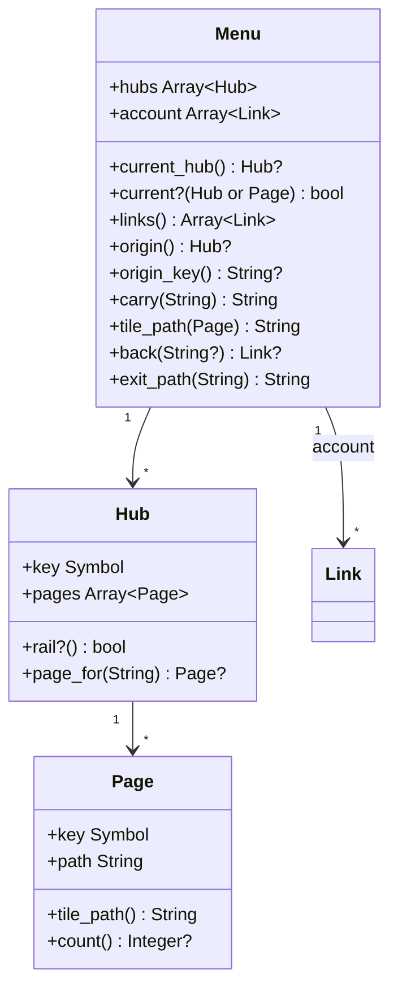
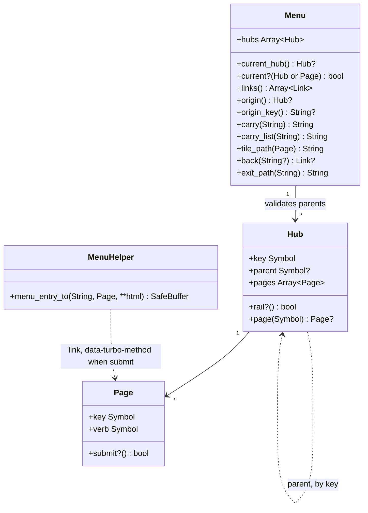
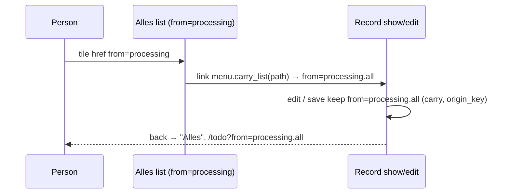

# Plan: Hubs under a parent hub, sign-out as a hub page, and a list origin

From `intent.md` (2026-11-12). Status: accepted.

Context: appkit `709fcac` ships `Appkit::Menu` with an account pop-up (`_account_menu`), `account:` links and `Hub(rail: false)`. Journal Administration's navigation-hubs branch replaces the pop-up with a 👤 Profiel hub and waits for this change before it bumps appkit. This plan is self-contained: it names every file, signature and test.

## Design

### Domain terms

- **Hub**, **Page**, **Rail**, **Hub column**, **Origin**, **Tile**: as built in `Appkit::Menu` (`app/models/appkit/menu.rb` and `menu/`).
- **Parent hub** — the rail hub that the rail marks while a hub without a rail item of its own is current (`GLOSSARY.md`).
- **Submit page** — a page whose tile and hub-column item send one non-GET request, such as Uitloggen; no controller, count, badge or filter; search leaves it out (`GLOSSARY.md`).
- **List origin** — an origin that also names the list a flow started from, written `from=<hub>.<page>`, such as `processing.all` (`GLOSSARY.md`).

### Diagrams

Before (`709fcac`):



`_nav` ends the rail with `<li>` + `_account_menu` (a `<details>` with `user_name`, the account links and a sign-out `button_to`).

After:



Sequence, list origin (Journal's Alles):



### Signatures

```ruby
module Appkit
  # Places one request in the menu map. The account: keyword and #account are removed.
  class Menu
    # Raises ArgumentError when a hub's parent names no hub in the map, or names a hub that has a parent itself.
    #: (hubs: Array[Hub], controller_path: String, params: Hash[String, untyped]) -> void
    def initialize(hubs:, controller_path:, params:)

    # A page: true for the current page. A hub: true for the current hub, or for the current hub's parent hub.
    #: (Hub | Page) -> bool
    def current?(entry)

    # Every hub and every page that is not a submit page, as a label and a path, each path once, for search.
    #: () -> Array[Link]
    def links

    # The hub named by the hub part of params["from"]; nil for an unknown key.
    #: () -> Hub?
    def origin

    # "<hub>" or, when the page part names a GET page of that hub, "<hub>.<page>"; nil without an origin. A submit page or an unknown page in the page part degrades to "<hub>".
    #: () -> String?
    def origin_key

    # Unchanged contract: { from: origin_key } or {}.
    #: () -> Hash[Symbol, String]
    def origin_params

    # Unchanged contract: the path with from=<origin_key>; a list origin travels on.
    #: (String) -> String
    def carry(path)

    # For links from a list to its records: from=<hub>.<current page>, where the hub is the origin hub when the current page belongs to it, else the current hub (a list opened from the hub column has no origin). Without a current GET page, carry(path).
    #: (String) -> String
    def carry_list(path)

    # A submit page's own path, with no origin; otherwise as before.
    #: (Page) -> String
    def tile_path(page)

    # On a record: the list origin's page when the origin names one, else the origin hub's page for the controller, else the fallback. On a list: the origin landing page, as before.
    #: (?String?) -> Link?
    def back(fallback = nil)

    # Unchanged: the origin hub's landing page, else the fallback (a list origin still exits to its hub).
    #: (String) -> String
    def exit_path(fallback)
  end

  class Menu
    # A hub. parent: replaces rail:.
    class Hub
      #: (key: Symbol, label: String, emoji: String, path: String, landing: Hash[String, String], ?pages: Array[Page], ?controllers: Array[String], ?action: Link?, ?parent: Symbol?) -> void
      def initialize(key:, label:, emoji:, path:, landing:, pages: [], controllers: [], action: nil, parent: nil)

      attr_reader :parent #: Symbol?

      # True when the hub has no parent hub, so the rail lists it.
      #: () -> bool
      def rail?

      # Its page with this key, nil otherwise.
      #: (Symbol) -> Page?
      def page(key)
    end

    # One page of a hub: it opens a list (GET), or it sends one request (a submit page).
    class Page
      # verb defaults to :get. Raises ArgumentError for a verb outside get, post, patch, put and delete, and for a submit page with controllers, a filter, a tile_path, a count or a summary.
      #: (key: Symbol, label: String, path: String, controllers: Array[String], ?filter: Hash[String, String], ?tile_path: String?, ?count: (^() -> Integer)?, ?summary: (^() -> String)?, ?verb: Symbol) -> void
      def initialize(key:, label:, path:, controllers:, filter: {}, tile_path: nil, count: nil, summary: nil, verb: :get)

      attr_reader :verb #: Symbol

      # True when the page sends a request other than GET.
      #: () -> bool
      def submit?
    end
  end

  # Renders a menu entry for a page as a link; a submit page's link also carries data-turbo-method with its verb,
  # so tiles and hub-column items keep the li > a markup that mvpa.css styles.
  # @rbs module-self ::ActionView::Base
  module MenuHelper
    #: (String, Menu::Page, **untyped) { () -> untyped } -> ActiveSupport::SafeBuffer
    def menu_entry_to(path, page, **html_options, &block)
  end
end
```

`app/views/appkit/shared/_nav.html.erb` drops the `user_name` local and the account `<li>`, and renders hub-column entries with `menu_entry_to page.path, page, "aria-current": …`. `app/views/appkit/shared/_account_menu.html.erb` goes. The `appkit.navigation.logout` and `appkit.navigation.preferences` keys stay, for hosts to use as labels.

Checked by: steep check

### Complexity

- `Menu.new`: one pass over the hubs to validate parents, O(hubs). No queries.
- `current?(hub)`: O(1) after the memoized placement.
- `links`: O(pages), `uniq` on path. No queries: a page's count lambda is never called by `links`.
- `origin`, `origin_key`: parse `from` once, O(hubs + pages of the origin hub). No queries.
- Rendering the nav and a landing page runs each count lambda of the current hub at most once, as before; a submit page has no count, so the Profile hub runs zero count queries.

### Invariants

- A parent hub exists in the map and has no parent itself: enforced in `Menu#initialize` (`ArgumentError`).
- A submit page owns no controller and has no filter, tile path, count or summary, so it can never be current and never shows a badge: enforced in `Page#initialize` (`ArgumentError`).
- A page's verb is one of get, post, patch, put, delete: enforced in `Page#initialize`.
- `origin_key` only ever names a hub, or a GET page of that hub, in the map: enforced by parsing `from` against the map in `Menu`. So a back link never points at a submit page's path.
- Tiles and hub-column items are `li > a`: enforced by `MenuHelper#menu_entry_to` (always `link_to`).

### Alternatives

1. **Chosen: `parent:` on the hub, `verb:` on the page, `menu_entry_to` renders a link with `data-turbo-method`.** One map shape for every hub; no new CSS; the account hub is built by the host from the same parts.
2. **`button_to` for submit entries.** Rejected: it renders `li > form > button`, which mvpa.css styles neither as a tile nor as a hub-column item, so Uitloggen would look unlike its neighbours (intent: "look like every other tile and item").
3. **An appkit-built account hub (`Menu.new(account_hub: …)`) that appends sign-out itself.** Rejected: a second way to build a hub, and appkit would own labels and ordering the host already owns. The intent decided one way to build an account hub.
4. **List origin as a separate `list=` parameter.** Rejected: every carrying call site (`carry`, `origin_params`, `hidden_field_tag :from, menu.origin_key`) would need a second value; one validated `from` value travels through the existing host code unchanged.

## Design decisions

- `rail:` is removed rather than kept as an alias: only Journal uses `Appkit::Menu`, and the intent removes the pop-up for good. A host that passes `rail:` gets `ArgumentError: unknown keyword`, which the Upgrading steps cover.
- `origin_key` returns the list origin (`processing.all`) so the existing host hidden fields and `origin_params` carry it through save and cancel with no host change; `origin` still returns the hub, so `exit_path` and the list back link are unchanged.
- An unknown page part (`from=processing.bogus`), or one that names a submit page (`from=profile.sign_out`), degrades to the hub origin, as an unknown hub key degrades to no origin today.
- `carry_list` without an origin names the current hub and page, so a combined list opened from the hub column (no `from`) still brings its records back. Consequence: such a record exits (`exit_path`) to the hub landing page instead of the host's fallback; the intent's criterion "returns to that list" wins over the old fallback.
- A submit page also refuses `tile_path:`: `Menu#tile_path` returns the page's own path for a submit page, so a different tile path would be dead data.
- The existing CHANGELOG `### Upgrading` steps 7–9 describe `account:`, `rail: false`, `user_name` and the account menu. They are rewritten to the new API, for a host that has not adopted the menu yet. New steps 12–17 follow, for a host that already followed the old wording; one `### Upgrading` section, as `AGENTS.md` requires. Their text:
  - 7 (rewritten): build `Appkit::Menu.new(hubs:, controller_path: controller_path, params: request.parameters)`; a hub without its own rail item takes `parent: <rail hub key>` and still gets its hub column, and the rail marks its parent while it is current; a parent must be a rail hub.
  - 8 (rewritten): render `render layout: "appkit/shared/nav", locals: { menu: menu } do … end` as the only content of `<body> > <header>`; put the Voorkeuren page and a sign-out submit page (`Appkit::Menu::Page.new(key: :sign_out, label: t("appkit.navigation.logout"), path: session_path, controllers: [], verb: :delete)`) in an account hub of your own.
  - 9 (rewritten): link every tile with `menu_entry_to menu.tile_path(page), page do … end` (a submit page's tile then sends its verb); link a list's records with `menu.carry_list(path)`; the `from` carrying calls (`carry`, `origin_params`, `hidden_field_tag :from, menu.origin_key`), `back` and `exit_path` stay as they are. The `render "appkit/shared/account_menu"` sentence goes.
  - 12: remove `account:` from `Appkit::Menu.new`; turn each account link into a page of a rail hub of your own (for example a 👤 hub).
  - 13: replace `rail: false` with `parent: <key of the rail hub that should light up>`.
  - 14: add the sign-out submit page last to that hub, as in step 8.
  - 15: render landing tiles with `menu_entry_to`, as in step 9.
  - 16: drop `user_name:` from the `appkit/shared/nav` locals, and delete every `render "appkit/shared/account_menu"`; the partial is gone.
  - 17: make sure every page with the nav loads Turbo: `import "@hotwired/turbo-rails"` in `app/javascript/application.js` and `<%= javascript_importmap_tags %>` in the layout. Without it, a submit page's link sends GET and fails.
  - Optional, not a step: link records from a combined list with `menu.carry_list`, so they return to it.
- The `### Added` and `### Changed` bullets that mention the account menu are updated to the new behaviour, since `## Unreleased` describes the state at the next pin.
- No conflict with `intent.md`'s `## Decisions`.

## Integration points

- Journal Administration (`app/controllers/concerns/menu_map.rb`, `app/views/hubs/show.html.erb`, its layout) adopts this in its navigation-hubs phase E2.
- mvpa.css styles `main nav:not(header nav) > ul > li > a` (tiles) and `nav.rail + nav` (hub column); this change keeps `li > a`, so no mvpa.css change is needed. The unused pop-up CSS cleanup is a separate mvpa.css change.
- Turbo turns `data-turbo-method` links into form submissions with the CSRF token. `turbo-rails` is a gemspec dependency and pins `@hotwired/turbo-rails` in the host importmap, but a host must still import it (`import "@hotwired/turbo-rails"` in its `application.js`) and render `javascript_importmap_tags`; the dummy app does neither today, so this change adds both, and the Upgrading steps name the requirement.
- `Appkit::SessionsController#destroy` (sign-out) redirects to `root_url`; the host's `root` then redirects an unauthenticated request to sign-in.

## Files that change

- `app/models/appkit/menu.rb` — drop `account`; validate parents; `current?` marks the parent; `links` skips submit pages and dedupes; list origin parsing in `origin`/`origin_key`; new `carry_list`; `tile_path` for submit pages; `back` uses the list origin's page.
- `app/models/appkit/menu/hub.rb` — `parent:` replaces `rail:`; `rail?` reads `parent`; new `page(key)`.
- `app/models/appkit/menu/page.rb` — `verb:`, `submit?`, argument validation.
- `app/helpers/appkit/menu_helper.rb` — new `Appkit::MenuHelper#menu_entry_to`.
- `app/views/appkit/shared/_nav.html.erb` — no `user_name`, no account `<li>`, entries through `menu_entry_to`.
- `app/views/appkit/shared/_account_menu.html.erb` — deleted.
- `sig/**` — regenerated with `bundle exec rake rbs:generate` (menu, hub, page, new `sig/helpers/appkit/menu_helper.rbs`).
- `test/dummy/app/controllers/application_controller.rb` — the map in Test setup; no `account:`.
- `test/dummy/app/controllers/inbox_controller.rb`, `test/dummy/app/views/inbox/index.html.erb`, `test/dummy/config/routes.rb` — a combined list (`get "inbox"`) for the list-origin flow; routes also gain `settings`, `admin/:id/edit` and `patch admin/:id`.
- `test/dummy/app/views/layouts/application.html.erb` — no `user_name` local; renders `javascript_importmap_tags`.
- `test/dummy/app/javascript/application.js` — `import "@hotwired/turbo-rails"`.
- `test/dummy/app/controllers/settings_controller.rb`, `test/dummy/app/views/settings/index.html.erb` — Setup's routed Settings page (`get "settings"`).
- `test/dummy/app/controllers/admin_controller.rb`, `test/dummy/app/views/admin/edit.html.erb`, `test/dummy/app/views/admin/show.html.erb` — a record edit form (hidden `from`, Cancel through `menu.carry`) and an update that redirects to `menu.carry(admin_record_path(id))`; no model, the dummy only proves the origin travels.
- `test/dummy/app/views/hubs/show.html.erb` — tiles through `menu_entry_to`.
- `test/dummy/app/views/admin/index.html.erb` — record link through `menu.carry_list`; `origin_flow_test.rb` then expects `from=work.admin`.
- `test/types/host_probe.rb` — `parent:`, `verb:`, no `account:`, `carry_list`, `menu_entry_to` is not probed (a view helper).
- `test/models/appkit/menu_test.rb`, `test/models/appkit/menu/hub_test.rb`, `test/models/appkit/menu/page_test.rb`, `test/helpers/appkit/nav_test.rb`, new `test/helpers/appkit/menu_helper_test.rb`, `test/integration/nav_current_page_test.rb`, `test/integration/origin_flow_test.rb`, `test/integration/nav_queries_test.rb`, new `test/integration/sign_out_entry_test.rb`.
- `CHANGELOG.md` — `### Added`/`### Changed` bullets and `### Upgrading` steps.
- `README.md` — only if it mentions the account menu (it does not today: checked with `grep -n -i "menu\|rail" README.md`).

No MCP, gem, migration, deploy or locale change.

## Order of work

1. Write the acceptance tests in the dummy app (`nav_current_page_test.rb`, `sign_out_entry_test.rb`, `origin_flow_test.rb`) against the new dummy map; run them; watch them fail (unknown keyword `parent:`/`verb:`).
2. `Page`: `verb:`, `submit?`, validation; unit tests.
3. `Hub`: `parent:`, `rail?`, `page(key)`; unit tests.
4. `Menu`: drop `account:`, parent validation, `current?`, `links`, `tile_path`; unit tests.
5. `Menu`: list origin (`origin`, `origin_key`, `carry_list`, `back`); unit tests.
6. `MenuHelper#menu_entry_to`; helper test.
7. `_nav` and delete `_account_menu`; update `nav_test.rb`.
8. Dummy app (map in Test setup) and `host_probe.rb`; acceptance tests green.
9. `bundle exec rake rbs:generate`, `rbs:check`, `steep`.
10. CHANGELOG.
11. Full checks: tests, rubocop, erb_lint, both Brakeman runs, bundler-audit.

## Risks

- Removing `account:`/`rail:` breaks Journal's current pin until its phase E2 lands; Journal pins a SHA, so nothing breaks until it bumps.
- `data-turbo-method` needs Turbo on the page; without it the sign-out link performs a GET to `/session`, which has no GET route and returns 404. The Upgrading steps require hosts to import Turbo; a no-JS fallback is out of scope.
- appkit has no browser test gems (no Capybara or Selenium), and adding one is a stop-and-ask. A real click is therefore proved in Journal's system tests (its phase E2: Uitloggen tile and hub-column item). appkit proves the markup, that the dummy page loads Turbo, and that the link's own verb and path sign out.
- A host whose `from` values contain a dot in a hub key would mis-parse; hub keys are Ruby symbols chosen by the host, and the parser splits on the first dot only, so `from=a.b` with a hub `:"a.b"` is not supported. Documented in the `origin` comment.

## Proof

- With Beheer under Profiel, a Beheer page marks Profiel in the rail and the rail lists no Beheer item → `test/integration/nav_current_page_test.rb` `a page of a hub under a parent marks the parent in the rail` (routed Settings page) and `a landing page of a hub under a parent marks the parent in the rail`
- A missing or nested parent refuses to build → `test/models/appkit/menu_test.rb` `a parent that names no hub raises`, `a parent that has a parent raises`
- The Profiel landing page shows an Uitloggen tile last; clicking it ends the session and shows the sign-in page → `test/integration/sign_out_entry_test.rb` `the sign-out tile is last and signs out` (sends the link's own `data-turbo-method` to its `href`, follows to sign-in, then a protected page redirects to sign-in); `the nav page loads Turbo` (the page's importmap pins and imports `@hotwired/turbo-rails`). A real click: Journal's system tests, phase E2 (see Risks)
- The Profiel hub column shows Uitloggen last, no badge; clicking it signs out → `test/integration/sign_out_entry_test.rb` `the sign-out hub-column item is last and signs out`
- The Uitloggen tile and hub-column item are `li > a` → `test/integration/sign_out_entry_test.rb` (both tests above assert `li:last-child > a[data-turbo-method='delete']`), `test/helpers/appkit/menu_helper_test.rb` `a submit page renders a link with data-turbo-method`
- On a Beheer page the hub column shows Beheer's own pages → `test/integration/nav_current_page_test.rb` `a page of a hub under a parent marks the parent in the rail` (asserts the Setup hub column and its current Settings item)
- Search finds no Uitloggen and Voorkeuren once → `test/models/appkit/menu_test.rb` `links skips submit pages and lists each path once`
- The rail holds no pop-up: no `<details>`, no user name → `test/integration/nav_current_page_test.rb` `the rail holds no account pop-up`, `test/helpers/appkit/nav_test.rb` `nav renders no account pop-up`
- A record opened from a combined list returns to that list after edit and save; from its own page it returns to that page → `test/integration/origin_flow_test.rb` `a record opened from a combined list returns to it after edit and save`, `a record opened from a combined list in the hub column returns to it`, `a record opened from its own page returns to that page after edit and save`, `cancel on the edit form keeps the list origin`; `test/models/appkit/menu_test.rb` `back on a record with a list origin leads to that list`
- Query count: the Profile hub landing page runs no count query → `test/integration/nav_queries_test.rb` `a hub with only uncounted pages runs no count`
- Invariant: a submit page owns no controller and has no filter, tile path, count or summary, enforced by `Page#initialize` → `test/models/appkit/menu/page_test.rb` `a submit page refuses controllers, a filter, a tile path, a count or a summary`
- Invariant: a verb outside get, post, patch, put, delete is refused, enforced by `Page#initialize` → `test/models/appkit/menu/page_test.rb` `an unknown verb raises`
- Invariant: `origin_key` names only hubs and GET pages in the map, enforced by `Menu#origin_key` → `test/models/appkit/menu_test.rb` `an unknown page in a list origin degrades to the hub origin`, `a submit page in a list origin degrades to the hub origin`
- Signatures → check: `bundle exec rake rbs:check` and `bundle exec rake steep`

Per changed file, the unit tests expected, named as behaviour:
- `app/models/appkit/menu/page.rb`: `verb defaults to get`, `submit? is true for a non-GET verb`, `an unknown verb raises`, `a submit page refuses controllers, a filter, a tile path, a count or a summary`, `a submit page scores 0`.
- `app/models/appkit/menu/hub.rb`: `rail? is true without a parent`, `rail? is false with a parent`, `parent is stored`, `page returns its page by key, nil otherwise`.
- `app/models/appkit/menu.rb`: `a parent that names no hub raises`, `a parent that has a parent raises`, `current? marks the parent hub of the current hub`, `current? does not mark an unrelated hub`, `links skips submit pages and lists each path once`, `tile_path of a submit page is its own path, also on a landing page`, `origin reads the hub part of a list origin`, `origin_key keeps a list origin`, `an unknown page in a list origin degrades to the hub origin`, `carry carries a list origin`, `carry_list names the current page in the origin hub`, `carry_list without an origin names the current hub and page`, `carry_list when the current page is not in the origin hub names the current hub`, `carry_list without a current page is carry`, `a submit page in a list origin degrades to the hub origin`, `back on a record with a list origin leads to that list`, `back on a list with a list origin leads to the landing page`, `exit_path with a list origin is the hub landing page`.
- `app/helpers/appkit/menu_helper.rb`: `a page renders a plain link`, `a submit page renders a link with data-turbo-method`, `html options pass through and data merges`.
- `app/views/appkit/shared/_nav.html.erb` (`test/helpers/appkit/nav_test.rb`): `nav renders no account pop-up`, `nav marks the parent of a hub under it`, `nav renders a submit page as a link without a badge`.

Test setup: the dummy map becomes Overview (home), Work (Admin on `admin`, Reports on `reports`, both counted), Review (Open admin on `admin` with `filter: open`, and All on a new `inbox` controller: the combined list), Profile (👤, Preferences on `appkit/preferences`, Sign out as a submit page `verb: :delete`, `path: session_path`, `controllers: []`), and Setup (`parent: :profile`, Settings on a new routed `settings` controller). A new `InboxController#index` (`get "inbox"`) renders a link to `admin_record_path(7)` through `menu.carry_list`; `admin/index` links its record the same way. `AdminController` gains `edit` (a form with `hidden_field_tag :from, menu.origin_key` and a Cancel link through `menu.carry`) and `update` (redirects to `menu.carry(admin_record_path(params[:id]))`), with no model. The dummy layout renders `javascript_importmap_tags` and `application.js` imports Turbo. Fixtures: `users(:alice)` as administrator, signed in with `sign_in_as`, as the existing integration tests do.

---
Domain skills applied: software-design, rails-architecture, rails-ui, rails-testing, ruby-style, glossary, diagrams.

## Critique

### Round 1 (codex exec -m gpt-6.1-sol)

- `carry_list` loses the list when no origin exists: a combined list opened from the hub column carries nothing → fixed (carry_list names the current hub and page without an origin; Design decisions records the exit_path consequence; new flow test from the hub column)
- Request tests cannot prove a click signs out, the dummy loads no Turbo, and the claim that the gem dependency loads Turbo is false → fixed (claim corrected in Integration points; dummy layout and application.js load Turbo with a test; Upgrading step 17 names the requirement; the real click is proved by Journal's system tests, since adding a browser test gem to appkit is a stop-and-ask, recorded in Risks)
- The edit and save criterion is unproved by unit tests alone → fixed (dummy admin edit and update with hidden from and Cancel; flow tests through save and cancel from both lists)
- Visiting only Setup's landing page leaves parent highlighting on owned pages unproved → fixed (routed Settings page in Setup; Proof names a page test and a landing test)
- The Upgrading steps are promised but not specified, and step 9 teaches link_to for tiles → fixed (Design decisions spells out rewritten steps 7 to 9 and new steps 12 to 17, including menu_entry_to and Turbo)
- List-origin validation accepts submit pages, so from=profile.sign_out yields a back link to /session → fixed (origin_key accepts only GET pages; regression test a submit page in a list origin degrades to the hub origin)
