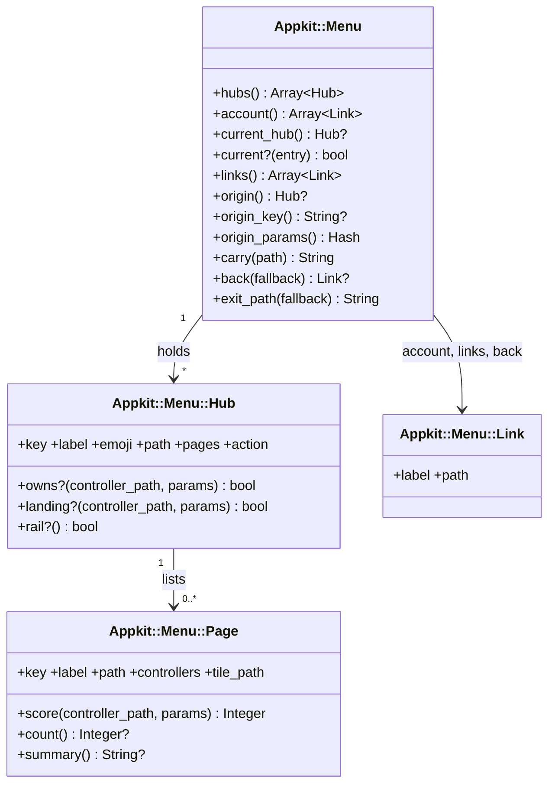
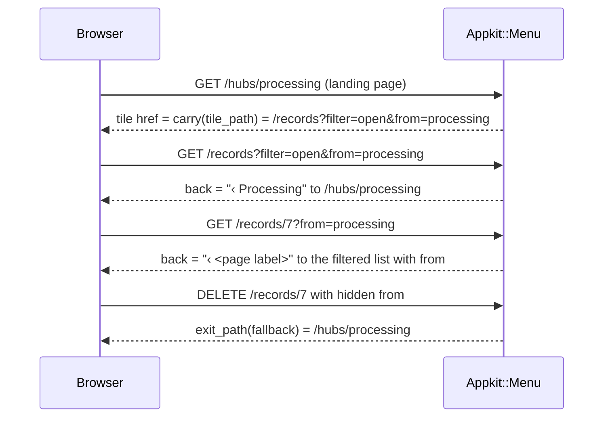

# Plan: Navigate by task hubs (appkit, phase A)

From `intent.md` (2026-10-25). Status: accepted.

This is phase A of journal_administration's accepted `docs/changes/navigation-hubs/plan.md` (branch `navigation-hubs`, commit `901550f`). Etienne chose on 2026-10-25 to copy that phase here instead of a separate appkit interview. Phases B (the app) and C (the mvpa.css bump) stay in journal_administration.

## Design

### Domain terms

Terms from journal_administration's glossary: **Hub**, **Hub column**, **Landing page**, **Rail**, **Menu map**, **Page**, **Tile**, **Badge**, **Origin**. appkit stays generic: it knows hubs, pages and links, never an app's models. A hub is never a "section" or a "tab"; "tab bar" names only the rail's phone form.

- **Menu map** — the one description of the hubs, their pages and the account menu; the rail, the hub column, the landing pages and search all draw from it.
- **Page** — one entry of a hub: a label, the controllers it owns, an optional filter, its list path, its tile path and an optional count or summary.
- **Badge** — the count next to a page in the hub column; a count of 0 shows no badge.
- **Origin** — the hub whose landing page started the current flow; it travels as the `from` query parameter.

### Diagrams

Before: `appkit/shared/_nav.html.erb` renders an `h2` with the app name, a home link, the yielded items, Voorkeuren and an Uitloggen `button_to`. It has no notion of hubs, current page or origin.

After:



The host app builds one `Appkit::Menu` per request from its own map and renders `_nav` with it. Origin flow, in a host app with a "processing" hub whose page filters a "records" list:



### Signatures

The host passes `params: request.parameters` (path and query parameters with String keys, never strong parameters); appkit reads only `"id"`, `"from"` and the keys a page's `filter:` names.

```ruby
# Places one request in the menu map: which hub and page are current, where the origin leads.
class Appkit::Menu
  #: (hubs: Array[Appkit::Menu::Hub], account: Array[Appkit::Menu::Link], controller_path: String, params: Hash[String, untyped]) -> void
  def initialize(hubs:, account:, controller_path:, params:)
  #: () -> Array[Appkit::Menu::Hub]      the rail hubs and any account-menu hub (Beheer), in map order
  attr_reader :hubs
  #: () -> Array[Appkit::Menu::Link]     account menu entries; the partial appends Uitloggen
  attr_reader :account
  #: () -> Appkit::Menu::Hub?
  def current_hub
  #: (Appkit::Menu::Hub | Appkit::Menu::Page) -> bool
  def current?(entry)
  #: () -> Array[Appkit::Menu::Link]     every hub and page as a label and path, for search
  def links
  #: () -> Appkit::Menu::Hub?            the hub named by params["from"], nil for an unknown key
  def origin
  #: () -> String?                       the validated origin key, for hidden_field_tag :from
  def origin_key
  #: () -> Hash[Symbol, String]          {from: key} or {}, for button_to params: and url options
  def origin_params
  #: (String) -> String                  the path with from=<origin key> merged into its query, unchanged without an origin
  # URI-aware: keeps the existing query (?filter=open), replaces an existing from, escapes the value, keeps a #fragment.
  def carry(path)
  #: (?String?) -> Appkit::Menu::Link?   the title-bar back link; nil on a list without an origin
  # A record is a request with params["id"] that is no hub's landing page; every other request, new and a failed create included, is a list.
  def back(fallback = nil)
  #: (String) -> String                  where a delete lands: the origin landing page, else the fallback
  def exit_path(fallback)
end

# A hub: its landing page, its pages and the controllers it owns without a page.
class Appkit::Menu::Hub
  #: (key: Symbol, label: String, emoji: String, path: String, landing: Hash[String, String], ?pages: Array[Appkit::Menu::Page], ?controllers: Array[String], ?action: Appkit::Menu::Link?, ?rail: bool) -> void
  # landing: the request that is this hub's landing page, as a controller path plus params,
  #   for example {"controller" => "hubs", "id" => "processing"} or {"controller" => "dashboard"}.
  # rail: false keeps the hub out of the rail (Beheer, reached from the account menu); it still gets a hub column and can be current.
  # Raises ArgumentError when two pages share a controller, so a hub key always restores one list.
  def initialize(key:, label:, emoji:, path:, landing:, pages: [], controllers: [], action: nil, rail: true)
  #: () -> Appkit::Menu::Link?           a title-bar action for the host's landing page (Importeren); the nav does not render it
  attr_reader :key, :label, :emoji, :path, :pages, :action
  #: (String, Hash[String, untyped]) -> bool   true for its landing request or a page-less controller it owns
  def owns?(controller_path, params)
  #: (String, Hash[String, untyped]) -> bool   true for the request that is its landing page; Menu reads it so a landing id is never a record
  def landing?(controller_path, params)
  #: () -> bool                          false for a hub kept out of the rail
  def rail?
end

# One page of a hub and what needs attention there; count and summary are lazy and memoized.
class Appkit::Menu::Page
  #: (key: Symbol, label: String, path: String, controllers: Array[String], ?filter: Hash[String, String], ?tile_path: String?, ?count: (^() -> Integer)?, ?summary: (^() -> String)?) -> void
  attr_reader :key, :label, :path
  #: () -> Array[String]                the controllers whose requests it owns; Menu and Hub read it, filter: stays private
  attr_reader :controllers
  #: () -> String                        the filtered list a tile opens; defaults to path
  def tile_path
  #: (String, Hash[String, untyped]) -> Integer
  # 2: a filtered page whose controller and filter both match, on a request without params["id"].
  # 1: an unfiltered page whose controller matches (any action, so show, edit and new too).
  # 0: otherwise; a filtered page never matches without its filter, nor on a record (params["id"] present).
  def score(controller_path, params)
  #: () -> Integer?                      runs the count lambda at most once
  def count
  #: () -> String?                       runs the summary lambda at most once; data for the host's tile, the nav does not render it
  def summary
end

# A label and a path. A plain class with inline signatures, so rbs:generate emits its constructor and readers.
class Appkit::Menu::Link
  #: (label: String, path: String) -> void
  def initialize(label:, path:)
  #: () -> String
  attr_reader :label, :path
end
```

Views:

- `appkit/shared/_nav.html.erb` (replaced). It stays a layout partial, as today. The host calls `render layout: "appkit/shared/nav", locals: { menu: menu, user_name: Current.user.name } do … end`, and the block (the search button) renders at the top of the rail. Renders `nav.rail`: a yielded block at the top (the host's search button), one `li` per hub whose `rail?` is true, with emoji and label, then the account `li` with `_account_menu`. Then `nav.hub-column` for the current hub when it has pages, also for a hub kept out of the rail: an `h2` linking to the landing page, a `ul` of page links, each with `<data value>` when the count is above 0. The rail marks the current hub with `aria-current="true"`; the hub column marks the current page with `aria-current="page"`. Both navs have translated `aria-label`s.
- `appkit/shared/_account_menu.html.erb` (new). Locals `menu:`, `user_name:`, `avatar: false`. A `<details>` whose summary is the user's name, or "👤" with `aria-label` set to the user's name when `avatar: true`. It lists `menu.account` and ends with the Uitloggen `button_to`.

### Complexity

Matching, origin and links run in memory over the map, about 20 pages: 0 queries. The count lambdas are the host's and may query. The nav calls `count` only for the pages of the current hub, each at most once per request (memoized), so a nav render costs at most one host count per page of the current hub, and none on a hub without pages. A tile and a badge in one request share the memoized count. Proof: a query-count test in the dummy app.

### Invariants

- At most one hub and one page are current. Enforced by the highest `Page#score`, ties to map order. Proof: `Appkit::MenuTest`.
- `from` only counts when it names a hub in the map, so `carry` and `exit_path` never forward an unknown value. Enforced by `Appkit::Menu#origin`. Proof: `Appkit::MenuTest`.
- A count lambda runs once per page per request. Enforced by memoization in `Page#count`. Proof: `Appkit::Menu::PageTest`.
- A hub holds at most one page per controller, so a hub-key origin restores exactly one list. Enforced by `Hub#initialize` raising `ArgumentError`. Proof: `Appkit::Menu::HubTest`.
- The nav renders no badge for a count of 0 or nil. Enforced in `_nav`. Proof: nav test.

### Alternatives

Taken from journal_administration's plan, where three architects designed for depth, least change and cheapest queries. Deepest modules was chosen: appkit owns `Menu`, `Hub`, `Page`, the matching and the origin rules, and callers know only `menu`, `carry`, `origin_key`, `origin_params`, `back` and `exit_path`. Route recognition was rejected in favour of explicit `controllers:` and `filter:` per page, which a reader can see in the map. A `default_url_options` origin was rejected because the origin would drift to every linked record.

## Design decisions

- **Origin is a hub key, not a page key.** On a record page the back link targets the origin hub's page that owns the record's controller. On a list opened with an origin the back link goes to the landing page.
- **Origin restores the opened list.** Only tiles set an origin, and a hub holds at most one page per controller (enforced), so that page's `tile_path` is the list the user opened. A hub-key origin is kept over a page key because journal_administration's map fits the rule and its accepted plan uses hub keys.
- **Landing match is configured per hub** (`landing:`), not hardcoded to a `hubs` controller, so a host can use the dashboard or any controller as a landing page.
- **`Hub#action` and `Page#summary` are plain data** for the host's landing page: the nav ignores them, and appkit tests only that they are stored and that `summary` runs once.
- **Back-link label.** A list from a tile shows "‹ <hub>"; a record shows "‹ <page>"; a record without an origin shows "‹ <owning page>" to the fallback.
- **The badge is left out at 0** by `_nav`, as well as hidden by mvpa.css, so a test can check it without CSS.
- **A record belongs to the unfiltered page.** A filtered page scores only on a list request. A record request that still carries the list's filter (`/records/7?filter=open`) scores 0 on the filtered page, so the unfiltered page and its hub are current: a transaction lights Administratie, not Verwerken. A controller with only filtered pages falls back to a hub that owns it, else no hub is current.
- **A record is a request with an id that is no landing page.** A landing page such as `hubs#show` has an id but counts as a list, so it has no back link without an origin. `new` and a failed `create` have no id and also count as lists: with an origin `back` leads to the origin landing page, without one it is nil. That is enough, because journal_administration's `new` views keep their own "Terug" link and no tile opens a `new` page.
- **Back-link labels carry no "‹" prefix.** `Link#label` is the plain hub or page label; the host's title bar adds the prefix, so no locale key is needed for it.
- **Phone avatar is "👤"**, labelled with the user's name.
- **`_nav` is replaced, not kept beside a new partial** (intent decision). Other apps follow the `### Upgrading` steps.
- **Markup contract** matches journal_administration's plan (`nav.rail`, `nav.hub-column`), which the mvpa.css rail slice adopts (Etienne, 2026-10-25). `ul.tiles` and the landing page are the host's views, not appkit's.
- **Delivery.** This phase ends with a verified appkit pull request. journal_administration's phase B starts after Etienne merges it.

## Integration points

- **Host apps**: build an `Appkit::Menu` per request (journal_administration does it in a `MenuMap` controller concern) and render `appkit/shared/nav` with `menu:` and `user_name:`. Any app that renders today's `_nav` breaks until it follows the Upgrading steps.
- **mvpa.css** styles `nav.rail` and `nav.hub-column` in a later slice; until then the markup renders with mvpa's existing `nav` styles. The `### Upgrading` steps tell a host to move `mvpa-css` to a commit whose CHANGELOG names the rail and hub column, because before that the new nav renders as plain lists.
- **Steep and RBS**: the new classes carry inline `#:` signatures; `sig/` is regenerated and `rbs:check` and `steep` stay green. `test/types/host_probe.rb` gains `Appkit::Menu::Link.new(label:, path:)`, a `Page`, a `Hub` with `landing:`, and `Appkit::Menu.new(...)` with `params: {}`, as a host would write them.

## Files that change

- `app/models/appkit/menu.rb`, `app/models/appkit/menu/hub.rb`, `app/models/appkit/menu/page.rb` — new; `Appkit::Menu::Link` sits in `menu.rb` or its own file, whichever Zeitwerk autoloads in the dummy app.
- `app/views/appkit/shared/_nav.html.erb` — replaced by the rail and hub column.
- `app/views/appkit/shared/_account_menu.html.erb` — new.
- `config/locales/{en,nl,it}.yml` — the rail and hub-column landmark labels, the back-link prefix if any, Uitloggen; remove keys the old `_nav` alone used.
- `test/models/appkit/menu_test.rb`, `test/models/appkit/menu/hub_test.rb`, `test/models/appkit/menu/page_test.rb` — new.
- `test/helpers/appkit/nav_test.rb` — rewritten for the new partials (it renders `render layout: "appkit/shared/nav"` today).
- `test/integration/app_name_test.rb` — `assert_name_in_nav` drops its `h2` assertion: the nav no longer renders the app name, and the hub column `h2` holds the hub label. The `title` assertion stays.
- `test/integration/nav_current_page_test.rb` — rewritten: it asserts the old Home link today; it now proves the dummy layout marks the current hub and page with `aria-current`, through real requests.
- `test/integration/nav_queries_test.rb` — new; the query-count proof.
- Dummy host: `test/dummy/config/routes.rb` gains `resources :hubs, only: :show`; `test/dummy/app/controllers/hubs_controller.rb` (new, renders a hub's page links); `test/dummy/app/controllers/application_controller.rb` gains a `menu` helper that builds a small map (an Overview hub landing on `home#index`, a Work hub landing on `hubs#show` with an unfiltered `admin` page and a filtered `admin?filter=open` page in another hub, counts as lambdas over `User`); `test/dummy/app/views/layouts/application.html.erb` renders the new nav.
- `test/types/host_probe.rb` — the additions named under Integration points.
- `sig/` — regenerated from inline RBS.
- `CHANGELOG.md` — under the existing `## Unreleased`: a `### Changed` line for the replaced `_nav`, and new numbered steps appended to the existing `### Upgrading` list, written so an agent in another app can follow them: build an `Appkit::Menu` per request from `request.parameters`; render `render layout: "appkit/shared/nav", locals: { menu:, user_name: }` with the search button as the block; move Voorkeuren into the account links; drop any reliance on the old home link and app-name heading; move `mvpa-css` to a commit whose CHANGELOG names the rail and hub column. No second `### Upgrading` section and no new heading format.

## Order of work

1. Write `Appkit::MenuTest`, `Appkit::Menu::HubTest` and `Appkit::Menu::PageTest` for scoring, landing match, the one-page-per-controller guard, current hub, origin guard, `carry`, `back` and `exit_path`; watch them fail.
2. Build `Appkit::Menu`, `Hub`, `Page` and `Link` until they pass.
3. Rewrite the nav test and `nav_current_page_test.rb` for the rail, hub column, badges (none at 0) and account menu; add the query-count test; replace `_nav`, add `_account_menu`; add the dummy route, `HubsController`, `menu` helper and layout.
4. Locales, `rake rbs:generate`, `rake rbs:check`, `rake steep`, the CHANGELOG entry with `### Upgrading`.
5. rubocop, erb_lint, both Brakeman runs, bundler-audit, the full test suite.
6. Review and deliver the appkit pull request. Stop there: Etienne merges it, then journal_administration's phase B starts.

## Risks

- **appkit consumers.** Replacing `_nav` breaks any other app that renders it; the `### Upgrading` entry is the mitigation.
- **Generic tests.** The engine has no app models, so the menu tests use a small fake map in the dummy app; the journal-specific criteria are proven in journal_administration phase B.
- **mvpa.css not ready.** Until the rail slice lands, the new nav looks like a plain list; this is accepted for phase A.

## Out of scope

- journal_administration's phases B and C: its menu map, landing pages, filters, origin wiring and the mvpa.css bump.
- The mvpa.css rail, hub column, tile grid and badges.
- Landing page and tile views; those belong to the host app.
- Any other appkit area: authentication, PWA, preferences, CI workflow.

## Proof

Phase A proves the generic behaviour that journal_administration's acceptance criteria rely on:

- Invariant: at most one current page, the higher score wins and ties go to map order, enforced by `Appkit::Menu#current_hub` → `test/models/appkit/menu_test.rb` `test_filter_match_beats_controller_match`
- Invariant: an unknown `from` is ignored, enforced by `Appkit::Menu#origin` → `test/models/appkit/menu_test.rb` `test_unknown_origin_is_ignored`
- Invariant: a count lambda runs once per page, enforced by `Page#count` → `test/models/appkit/menu/page_test.rb` `test_count_evaluates_its_lambda_once`
- Invariant: no badge at 0 → nav test `test_nav_shows_a_badge_above_zero_and_none_at_zero`
- Invariant: one page per controller in a hub → `test/models/appkit/menu/hub_test.rb` `test_two_pages_with_one_controller_raise`
- Query count: a dummy request on a hub with two counted pages runs each count query once, and a request on a hub without pages runs none → `test/integration/nav_queries_test.rb` `test_nav_runs_each_current_hub_count_once`
- The dummy layout marks the current hub and page through real requests → `test/integration/nav_current_page_test.rb` `test_landing_page_marks_its_hub`, `test_filtered_page_marks_its_hub_and_page`, `test_record_page_marks_the_unfiltered_page`, `a hub kept out of the rail still gets its hub column`

Per changed file, the unit tests expected:

- `app/models/appkit/menu.rb`: `current_hub picks the highest-scoring page`, `current_hub on a record edit is the unfiltered page's hub, not the filtered page's hub`, `current_hub on a landing request is the hub whose landing matches`, `current_hub falls back to a hub that owns the controller`, `current_hub can be a hub kept out of the rail`, `current_hub is nil for a request no hub owns`, `links lists every hub and page`, `origin_key and origin_params are empty without an origin`, `origin returns the hub named by from`, `origin ignores an unknown key`, `carry adds from only with an origin`, `carry merges into an existing query`, `carry replaces an existing from`, `carry keeps a fragment`, `back on a list with an origin leads to the landing page`, `back on a record with an origin leads to the origin hub's page for that controller`, `back on a record whose controller has no page in the origin hub uses the fallback`, `back without an origin uses the fallback and the owning page label`, `back on a list without an origin is nil`, `back on a landing page is nil, although its id is present`, `back on a new page counts as a list`, `exit_path prefers the origin landing page`, `exit_path without an origin is the fallback`.
- `app/models/appkit/menu/hub.rb`: `landing? is true only for its landing request`, `owns? is true for its landing request`, `owns? is false for another hub's landing id`, `owns? is true for a page-less controller it lists`, `two pages with one controller raise`, `rail? is true by default`, `rail? is false for a hub kept out of the rail`, `action is stored`.
- `app/models/appkit/menu/page.rb`: `score is 2 for controller and filter`, `score is 1 for an unfiltered page's controller`, `score is 0 for a filtered page without its filter`, `score is 0 for a filtered page on a record`, `score is 0 otherwise`, `count evaluates its lambda once`, `count is nil without a lambda`, `summary evaluates its lambda once`, `controllers are public and filter is not`, `tile_path defaults to path`.
- `app/views/appkit/shared/_nav.html.erb`: `nav marks the current hub and page`, `nav shows a badge above 0 and none at 0`, `nav leaves out the hub column for a hub without pages`, `nav yields the top of the rail`, `nav keeps a hub out of the rail`, `nav renders the hub column of a current hub kept out of the rail`.
- `app/views/appkit/shared/_account_menu.html.erb`: `account menu lists the links and ends with Uitloggen`, `avatar form shows 👤 labelled with the user name`.

Test setup: the dummy app and a fake map built in the tests. No fixtures for app models.

---
Domain skills applied: software-design, object-oriented-design, rails-ui (interaction-design reference), rails-testing, glossary.

## Critique

### Round 1 (codex exec -p terra)

- `Hub#owns?` matched `hubs#show` by id with no landing configuration, which hardcodes a host route → fixed (`Hub` takes `landing:` as a controller path plus params; Overview can land on `home#index`; tests for landing match)
- The render API conflicted with today's yielded layout partial → fixed (the host calls `render layout: "appkit/shared/nav", locals: { menu:, user_name: } do … end`; the Upgrading steps name that call)
- `carry` could not merge into a tile path that already has a query → fixed (URI-aware merge that keeps the query, replaces an existing `from`, escapes and keeps a fragment; one test per case)
- A hub key alone cannot restore a list when a hub has two pages for one controller → fixed (`Hub#initialize` raises `ArgumentError` for a second page with the same controller; a hub key is kept because journal_administration's accepted plan relies on it and its map fits the rule)
- Hosts on an old mvpa-css would get the new markup unstyled → fixed (an Upgrading step moves `mvpa-css` to a commit whose CHANGELOG names the rail and hub column; the release is not gated, because journal_administration's phase C already waits for that slice)
- `test/integration/nav_current_page_test.rb` asserts the old Home link → fixed (rewritten to prove the current hub and page through real dummy requests; listed in Files that change and Proof)
- The dummy host has no hub route, controller or map → fixed (dummy `resources :hubs`, `HubsController`, a `menu` helper with a named map, and the layout are listed)
- `Hub#owns?`, `Page#summary`, the no-page fallback and the duplicate-controller case had no tests → fixed (HubTest added; summary, fallback and duplicate tests listed)
- The complexity claim ignored host count lambdas that query → fixed (bound stated as one count per page of the current hub; `nav_queries_test.rb` proves it)
- `params` type, the unused `action_name` and `Link`'s signature were unclear → fixed (`params: request.parameters` with String keys; `action_name` removed; `Link` is a plain class with inline signatures; `host_probe.rb` additions named)
- `Hub#action` and `Page#summary` expand phase A into landing-page behaviour → fixed (kept as plain data for the host's landing page, documented as not rendered by the nav, with storage and memoization tests only)
- The CHANGELOG plan created a dated entry and a second Upgrading section → fixed (a `### Changed` line and steps appended to the existing `### Upgrading` list under `## Unreleased`)
