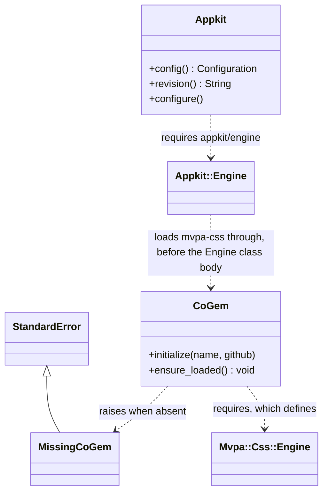
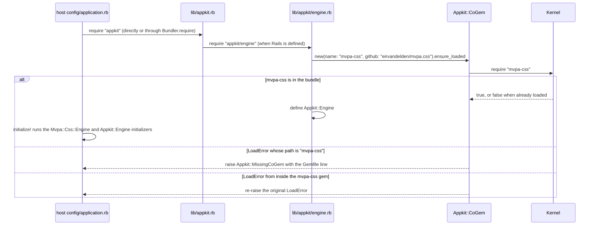

# Plan: Require mvpa-css at boot and fix login flashes placement

From `intent.md` (2026-10-30). Status: accepted.

## Design

### Domain terms

- **Host app**: the Rails app that installs appkit (`AGENTS.md`). In tests this is `test/dummy`.
- **Co-gem**: a gem that appkit needs at runtime but cannot declare in `appkit.gemspec`, because it comes from a git source. Each host app lists it in its own `Gemfile`. `README.md` and `AGENTS.md` already use this word. Avoid: peer dependency, optional dependency.
- **Boot**: everything from `require "appkit"` to the end of `Rails.application.initialize!`.
- **Flashes**: the `section[data-mvpa-flashes]` that the partial `appkit/shared/flashes` renders.

The repository has no `GLOSSARY.md`, so no agreed term conflicts with these.

### Diagrams

Before: `lib/appkit.rb` requires its gemspec dependencies, then `appkit/engine` when `Rails` is defined. Nothing in appkit names mvpa-css. The dummy app never loads mvpa-css, so `Mvpa::Css` is undefined in the test process.

After:





The login layout changes from `body > main > (flashes, yield)` to `body > (flashes, main > yield)`.

### Signatures

New file `lib/appkit/co_gem.rb`. It lives in `lib/`, not `app/`, because it runs before Zeitwerk and before `initialize!`.

```ruby
module Appkit
  # Raised at boot when a co-gem is missing from the host app's bundle.
  class MissingCoGem < StandardError; end

  # A gem that appkit needs at runtime but that each host app declares in its own Gemfile.
  class CoGem
    #: (name: String, github: String) -> void
    def initialize(name:, github:)
      @name = name
      @github = github
    end

    # Loads the co-gem, or raises MissingCoGem with the Gemfile line to add.
    #: () -> void
    def ensure_loaded
      require name
    rescue LoadError => error
      raise unless error.path == name

      raise MissingCoGem, missing_message
    end

    private
      attr_reader :name #: String
      attr_reader :github #: String

      #: () -> String
      def gemfile_line
        %(gem "#{name}", github: "#{github}")
      end

      #: () -> String
      def missing_message
        # the two sentences and the indented gemfile_line shown below
      end
  end
end
```

Every `def` and `attr_reader` carries an inline `#:` signature, because `test/signatures_test.rb` checks that. The private section follows the indented style of `app/models/appkit/app_name.rb`.

The message must make sense on its own, because `Bundler.require` wraps it after "Gem Load Error is: ":

```
appkit needs the mvpa-css gem, but the bundle does not have it. Add this line to the Gemfile and run bundle install:

  gem "mvpa-css", github: "eirvandelden/mvpa.css"
```

`lib/appkit/engine.rb` gets the check at its top, before `module Appkit`, so it runs before the `Appkit::Engine` class body defines the engine:

```ruby
require "appkit/co_gem"

# mvpa-css must be loaded before Appkit::Engine is defined, so initialize! also runs its initializers.
Appkit::CoGem.new(name: "mvpa-css", github: "eirvandelden/mvpa.css").ensure_loaded

module Appkit
  class Engine < ::Rails::Engine
    # unchanged
```

`lib/appkit.rb` does not change: it already requires `appkit/engine` only when `Rails` is defined. The `Appkit::Engine` class body does not change. `sig/appkit/co_gem.rbs` comes from `bundle exec rake rbs:generate`, never by hand.

Checked by: steep check

### Complexity

- Boot: one extra `Kernel#require`. It is O(1) and runs no queries. When mvpa-css is already loaded, it is a no-op.
- Requests: no cost. The login layout renders the same partial in a different place. Zero new queries.
- Tests: one subprocess boot of the dummy app, about 1 to 3 seconds.

### Invariants

1. When `Appkit::Engine` is defined, `Mvpa::Css::Engine` was defined before it, so `initialize!` runs the mvpa-css initializers. Enforced by the `CoGem` call at the top of `lib/appkit/engine.rb`, above the `Appkit::Engine` class body.
2. A host app whose bundle lacks mvpa-css never finishes `require "appkit"`. Enforced by `CoGem#ensure_loaded`.
3. The error message always holds `gem "mvpa-css", github: "eirvandelden/mvpa.css"`. Enforced by `CoGem#gemfile_line`, built from the same `name` that it requires.
4. A `LoadError` from inside an installed co-gem is never reported as `MissingCoGem`. Enforced by the `error.path == name` guard.
5. On the login layout, `[data-mvpa-flashes]` is never inside `<main>`. Enforced by `app/views/layouts/login.html.erb`.

### Alternatives

- **A. Appkit requires mvpa-css itself through `Appkit::CoGem` (chosen).** It works whatever the Gemfile order, with `require: false` on the mvpa-css line, and in a host that never calls `Bundler.require`. It fails before `initialize!`, and its public method takes a unit test with an injected gem name. Cost: two new constants and one public method.
- **B. An `appkit.mvpa_css` engine initializer that raises unless `defined?(::Mvpa::Css)` (rejected).** It is the smallest diff, with no new constant. It is rejected for three reasons:
  - It raises a false "add this line" error for a host that has the line with `require: false`, or that never calls `Bundler.require`. The dummy app is that case, so it needs a test-only `require "mvpa-css" unless ENV[...]` seam.
  - It passes when mvpa-css loads too late. A `require "mvpa-css"` after `initialize!` defines `Mvpa::Css`, but `Rails.application.railties` does not include `Mvpa::Css::Engine`, so its asset paths never register. This was checked in the dummy app.
  - Its logic lives in an initializer block, so only a subprocess boot can test it.
- **C. Option A as an inline `begin`/`rescue` in `lib/appkit/engine.rb`, without a class (rejected).** It adds no constant, but its `error.path` branch has no public seam and no test.

## Design decisions

- The check lives in the engine file, `lib/appkit/engine.rb`, as a load-time call above the `Appkit::Engine` class body, not as an initializer. `intent.md`'s In scope says "a boot-time check in the engine that raises when `Mvpa::Css` is not loaded". After `ensure_loaded` returns, `Mvpa::Css` is loaded; when it cannot be, the check raises. The chosen design keeps the agreed behaviour: a host without mvpa-css fails at boot with the Gemfile line, and a host with it boots. It also loads mvpa-css for a host that has the gem but does not require it. It contradicts no item in `intent.md`'s `## Decisions`: mvpa-css stays a co-gem, the check always raises, and there is no opt-out.
- `MissingCoGem` subclasses `StandardError`, not `LoadError`, so a host's `rescue LoadError` around an optional require cannot swallow it.
- The error text is plain English in Ruby, not i18n: it is a boot error for a developer, raised before I18n loads.
- `CoGem` takes the name and the GitHub path as arguments, so the unit tests can pass a gem name that does not exist.
- The dummy app (`test/dummy/config/application.rb`) does not change. It now gets mvpa-css only through `require "appkit"`, as a real host app would.
- The flashes move above `<main>` in `<body>`. mvpa-css styles `[data-mvpa-flashes]` as `position: fixed`, so the move does not change the login page layout. `app/assets/stylesheets/appkit/login.css` does not change.

## Integration points

- mvpa-css gem: appkit now names its entry file `mvpa-css` (`lib/mvpa-css.rb` in that gem). A rename there makes appkit report the gem as missing. Every host app also loads mvpa-css before `Appkit::Engine` from now on, so the mvpa-css asset paths come before the appkit ones.
- Bundler: `Bundler.require` wraps the error in `Bundler::GemRequireError` ("There was an error while trying to load the gem 'appkit'"). The appkit message follows in full after "Gem Load Error is:".
- Host apps that override the `login` layout: they keep flashes inside `<main>` until they move them. The `### Upgrading` step tells them.

## Files that change

- `lib/appkit/co_gem.rb` — new: `Appkit::MissingCoGem` and `Appkit::CoGem`.
- `lib/appkit/engine.rb` — require `appkit/co_gem`; load mvpa-css through `CoGem` above the `Appkit::Engine` class body.
- `sig/appkit/co_gem.rbs` — generated by `bundle exec rake rbs:generate`.
- `app/views/layouts/login.html.erb` — move `<%= render "appkit/shared/flashes" %>` out of `<main>`, directly above it, as a child of `<body>`.
- `test/appkit/co_gem_test.rb` — new: unit tests of `Appkit::CoGem`.
- `test/integration/mvpa_css_boot_test.rb` — new: subprocess boot test without mvpa-css, and the railties test with it.
- `test/controllers/appkit/sessions_controller_test.rb` — new test: the rejection flash renders outside `<main>`.
- `CHANGELOG.md` — `## Unreleased`: one `### Added` line, one `### Changed` line, and steps 5 and 6 in the existing `### Upgrading`.
- `README.md` — line 5: say that appkit raises at boot when mvpa-css is missing, and that it requires mvpa-css itself.

## Order of work

1. Write the subprocess acceptance test in `test/integration/mvpa_css_boot_test.rb`. Run it and watch it fail: today the boot succeeds without mvpa-css.
   - Follow the `Open3.capture2e` and `isolated_env` pattern of `test/signatures_test.rb` (remove `GIT_*` variables, set `BUNDLE_GEMFILE` to the repository `Gemfile`), with `RAILS_ENV=test` and `chdir` at the repository root.
   - Command: `RbConfig.ruby, "-e", 'require "bundler/setup"; spec = Gem.loaded_specs.fetch("mvpa-css"); $LOAD_PATH.reject! { |path| path.start_with?(spec.full_gem_path) }; require "./test/dummy/config/environment"'`. This load-path strip makes `require "mvpa-css"` raise a `LoadError` whose `path` is `"mvpa-css"`; this was checked.
   - Assert that the status is not a success, and that the output contains `Appkit::MissingCoGem` and `gem "mvpa-css", github: "eirvandelden/mvpa.css"`.
2. Write `test/appkit/co_gem_test.rb` (see Proof). Run it and watch it fail with `NameError` for `Appkit::CoGem`.
3. Add `lib/appkit/co_gem.rb` with the `#:` signatures. Run step 2's tests until green.
4. Change `lib/appkit/engine.rb`. Run step 1's test until green.
5. Add the railties test to `test/integration/mvpa_css_boot_test.rb`: with `classes = Rails.application.railties.map(&:class)`, assert that `classes` includes `::Mvpa::Css::Engine` and that its index is lower than the index of `Appkit::Engine`. It passes now and fails without step 4, because the dummy app never requires mvpa-css itself.
6. Run `bundle exec rake rbs:generate` and commit the new `sig/appkit/co_gem.rbs`. Run `bundle exec rake rbs:check` and `bundle exec rake steep`.
7. Add the layout test to `test/controllers/appkit/sessions_controller_test.rb`. Run it and watch the `body > section[data-mvpa-flashes]` assertion fail.
8. Move the flashes partial in `app/views/layouts/login.html.erb`. Run step 7's test until green.
9. Update `CHANGELOG.md` and `README.md`.
10. Run the full suite, `bundle exec rubocop`, `bundle exec erb_lint --lint-all`, both Brakeman runs and `bin/bundler-audit check --update` (commands in `AGENTS.md`).
11. Verify by hand: boot the dummy app with `RAILS_ENV=test bundle exec ruby -e 'require "./test/dummy/config/environment"; puts :ok'`, and run step 1's command by hand to read the error text as a developer would see it.

Out of scope: an mvpa-css version check, any opt-out, adding mvpa-css to the gemspec, host apps' own layouts and stylesheets, `login.css`, and other mvpa-css features.

## Risks

- **mvpa-css renames its entry file.** Appkit then reports an installed gem as missing. The unit test with the real gem name catches it on the next mvpa-css bump.
- **Load order changes in host apps.** mvpa-css now always loads before `Appkit::Engine`. Before, the Gemfile order decided this. The asset paths come mvpa-css first, then appkit; the dummy app showed that order and the full suite must pass with it.
- **The subprocess test simulates a missing gem** by removing its load path, not with a real second `Gemfile`. A second Gemfile needs its own lock resolution in CI, which is more fragile. This was rejected.
- **Hosts that override the login layout** keep their flashes inside `<main>` until they follow `### Upgrading`. Appkit cannot detect this.
- **Rejected: the initializer check (alternative B)**, for the false error and the late-load gap described under Alternatives.

## Proof

- Booting a host app without mvpa-css raises an error that says to add `gem "mvpa-css", github: "eirvandelden/mvpa.css"` to the `Gemfile` → `test/integration/mvpa_css_boot_test.rb` `test "booting without mvpa-css in the bundle raises with the Gemfile line"`
- Booting a host app with mvpa-css works as before → `test/integration/mvpa_css_boot_test.rb` `test "booting loads the mvpa-css engine before initialize"`, and the full suite, which boots the dummy app with mvpa-css on every run
- The login page has its `[data-mvpa-flashes]` section as a direct child of `<body>`, not inside `<main>` → `test/controllers/appkit/sessions_controller_test.rb` `test "the login page renders flashes outside main"`
- A flash set before login still shows on the login page → `test/controllers/appkit/sessions_controller_test.rb` `test "the login page renders flashes outside main"` (bad credentials set `flash[:alert]` and render the login layout; assert `body > section[data-mvpa-flashes] aside[role='alert']` and `main section[data-mvpa-flashes]` with `count: 0`)
- The `CHANGELOG.md` `### Upgrading` steps tell an app to add the `Gemfile` line and to move flashes out of an overridden login layout → check: read `## Unreleased` `### Upgrading` in `CHANGELOG.md`; step 5 holds `gem "mvpa-css", github: "eirvandelden/mvpa.css"`, step 6 says to move `<%= render "appkit/shared/flashes" %>` out of `<main>` to a direct child of `<body>` in an overridden `app/views/layouts/login.html.erb`
- Invariant: `Mvpa::Css::Engine` is loaded before `initialize!` and registers before `Appkit::Engine`, enforced by `lib/appkit/engine.rb` → `test/integration/mvpa_css_boot_test.rb` `test "booting loads the mvpa-css engine before initialize"`
- Invariant: a `LoadError` from inside an installed co-gem is never reported as `MissingCoGem`, enforced by `CoGem#ensure_loaded` → `test/appkit/co_gem_test.rb` `test "ensure_loaded re-raises a LoadError from inside the co-gem"`
- Query count: not affected; no new query.

Per changed file, the unit tests expected, named as behaviour:
- `lib/appkit/co_gem.rb`: `CoGem#ensure_loaded raises MissingCoGem with the Gemfile line when the gem is not in the bundle` (name `"appkit-absent-co-gem"`, github `"example/absent"`; assert the message contains `gem "appkit-absent-co-gem", github: "example/absent"`), `CoGem#ensure_loaded loads an installed co-gem without raising` (the real `mvpa-css`), `CoGem#ensure_loaded re-raises a LoadError from inside the co-gem` (assert a `LoadError` whose `path` is `"broken_co_gem/absent_part"`, not a `MissingCoGem`).
- `lib/appkit/engine.rb`: covered by the two tests in `test/integration/mvpa_css_boot_test.rb`.
- `app/views/layouts/login.html.erb`: covered by the sessions controller test.

Test setup: the broken co-gem fixture is a tmpdir with `broken_co_gem.rb`, which does `require "broken_co_gem/absent_part"`; the test adds the tmpdir to `$LOAD_PATH` and removes it in `ensure`. The subprocess test reuses the `isolated_env` idea from `test/signatures_test.rb`. No fixtures change.

---
Domain skills applied: None loaded. The playbook rules on tests, inline RBS and error handling applied.

## Critique

### Round 1 (codex exec -p terra)

- The plan leaves `Appkit::Engine` unchanged, but `intent.md` scopes the check "in the engine" → fixed (the check now sits at the top of `lib/appkit/engine.rb`, above the `Appkit::Engine` class body; `lib/appkit.rb` no longer changes)
- The `CoGem` signature shows its readers and private helpers as comments, which leaves them undefined and fails `test/signatures_test.rb` → fixed (Signatures now declare `attr_reader :name #: String`, `attr_reader :github #: String`, `gemfile_line` and `missing_message` with inline signatures)
- The railties test only checks that `Mvpa::Css::Engine` is present, not that it registers before `Appkit::Engine` → fixed (step 5 and the invariant Proof line now assert its railties index is lower than that of `Appkit::Engine`; checked in the dummy app: index 9 before 16 when mvpa-css loads first, 16 after 15 when it loads after the engine)
- The footer says no domain skills applied, which conflicts with the repository instructions → dismissed: no skill file was loaded in this session, so the footer records that truthfully instead of claiming skills; the playbook rules on tests, inline RBS and error handling that those skills carry are applied in the plan
- The co-gem term entry says the `Gemfile` already uses the word, but only the README does → fixed (the entry now cites `README.md` and `AGENTS.md`, which both say "co-gem")
