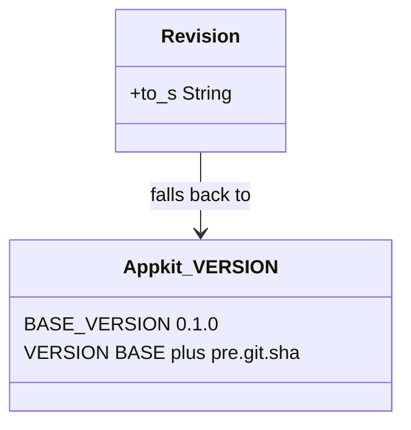
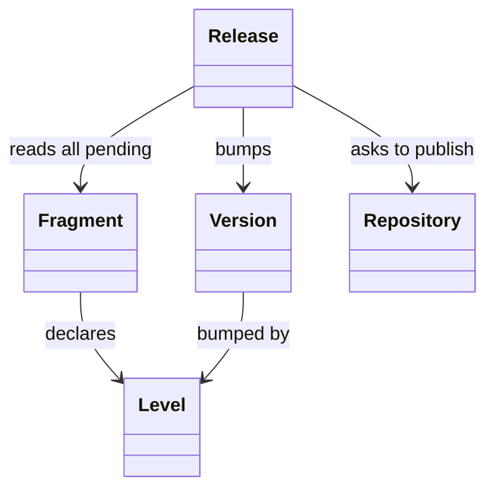
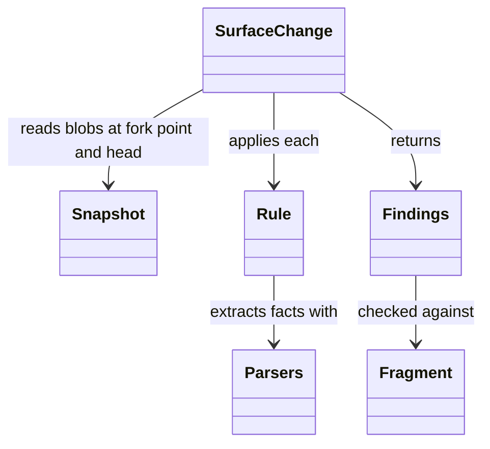
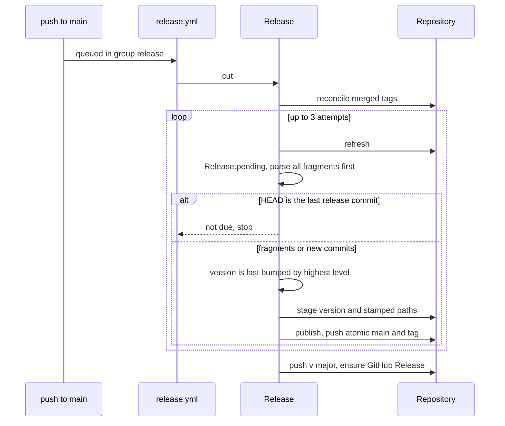

# Plan: Semantic versioning with automatic releases

Author: Etienne van Delden. Status: accepted (2026-11-25). Type: feature. Delivery: autonomous. Codex review: yes.

## Problem

Apps pin appkit to a git SHA. A SHA does not say whether an upgrade breaks the app, so an app owner cannot tell a safe bump from one that needs steps. The changelog is one `## Unreleased` block with 17 upgrade steps that mix several breaking changes. Nothing tells an agent or a reviewer that a change is breaking. Several branches are open at once, so no branch knows which version it will become.

## Proposed outcome

Appkit has real semver versions. A major version marks a breaking change, a minor version an opt-in feature, a patch version a bug or security fix. Each PR declares its level in its own fragment file and never writes a version number. A workflow on merge to `main` computes the next version, stamps it, tags it and publishes a release, so merge order never matters. A CI check stops a PR that looks breaking but declares less than major. Agent instructions say when and how to write the fragment. One retro pass gives the 24 merged PRs their versions, so the project starts from the correct number. The history also holds 44 direct commits on `main`, which belong to the baseline or to the next merge.

## Affected users and systems

- Host apps that pin appkit by SHA. They can move to `tag: "X.Y.Z"`; old SHA pins keep working.
- Etienne and the AI agents that open PRs in this repository.
- The mvpa.css repository, which adopts the same fragment format, level names and workflow shape, with its own copy of the script and the CI check (no shared gem or action).
- `lib/appkit/version.rb`, `sig/appkit/version.rbs`, `lib/appkit/revision.rb`, `appkit.gemspec`, `CHANGELOG.md`, `AGENTS.md` (`CLAUDE.md` is a symlink to it), `README.md`, `.github/workflows/`.
- `rails-ci.yml`, which apps call at `@main`.

## Constraints

- Approved by Etienne: edit files under `.github/workflows/`; push retro tags and create GitHub Releases on `origin`; add no new gem or package (stdlib, git and `gh` only).
- `main` has no branch protection, so the release workflow may push to it.
- Branches merge in any order. The version number is decided only at merge time, and runs are serialised.
- The apps' `### Upgrading` rule in `CLAUDE.md` is the definition of a major change.
- Same fragment format, level names and workflow shape as mvpa.css. Proposed shape, to settle in the plan: folder `changelog.d/`, file `<branch-slug>.md`, front matter `level: major|minor|patch`, body with `### Added`, `### Changed`, `### Fixed` and `### Upgrading` sections.
- Stamped changelog heading format, proposed to mvpa.css: `## X.Y.Z - YYYY-MM-DD`, newest first. Inside a version the sections come in the order Added, Changed, Fixed, Upgrading, and an empty section is omitted. The retro dates a version with its merge date.
- Retro numbering starts at 0.1.0, as in mvpa.css. Each breaking PR bumps major.
- `rails-ci.yml` must keep working for apps on `@main` during the change. A new input is optional with a default.

## In scope

- Retro pass: classify the 24 merged PRs as major, minor or patch; show a PR-to-version table; write nothing until Etienne approves it. Then tag the historic merge commits `X.Y.Z`, create GitHub Releases, and split the `## Unreleased` changelog into one section per version, with each Upgrading step under the right version.
- Fragment files: one per PR, with an explicit `level` and the changelog text. Highest level wins when a merge carries several.
- Release workflow on push to `main`: compute the version, stamp `version.rb` and `CHANGELOG.md`, delete the consumed fragments, commit, tag `X.Y.Z`, create the GitHub Release. A merge without a fragment still releases at least a patch. A concurrency group serialises runs.
- `Appkit::VERSION` becomes the plain released version. `Appkit::Revision` and the service worker cache name keep following the commit.
- CI check: fail a PR when its diff touches public surface and the declared level is below the detected floor. Public surface: migration templates, `Appkit.config` options, routes, public `sig/` signatures, gemspec runtime dependencies, `rails-ci.yml`. A documented way to override a false positive.
- Agent rules in `AGENTS.md` and `CLAUDE.md`: when a change is major, minor or patch; write the fragment; never edit a version by hand. The README explains how apps pin a tag.
- A moving major tag for the reusable workflow (such as `2`), moved by the release workflow, and an upgrade step telling apps to call it.
- Tests for the new code (the script that computes the version, and the CI check).

## Out of scope

- Committing `Gemfile.lock`, or changing how the gem resolves dependencies.
- Pushing the version to rubygems.org. Appkit stays a GitHub git gem.
- Changing the mvpa.css repository. Its own session owns that work.
- Moving host apps to the new tag. Each app does it itself.
- Backporting fixes to older majors.

## Acceptance criteria

- A branch adds `changelog.d/<branch-slug>.md` with `level: minor`, merges, and `main` gets a new minor version, a `X.Y.Z` tag and a GitHub Release.
- Two branches, one `level: major` and one `level: patch`, merge in either order: each merge gets the next correct version, and the major bump is never lost.
- A merge with no fragment releases a patch with a generated changelog line.
- A PR that adds a migration template, renames a public class or route, or changes a `sig/` signature, with `level: patch`, fails CI with a message that names the touched file and the minimum level.
- The same PR with `level: major` passes.
- After the retro pass, `git tag` lists the versions from the approved table, and each changelog section holds only its own Added, Changed, Fixed and Upgrading text.
- After the retro pass every row's version is the previous row's version bumped by that row's level, starting from 0.1.0, and the major number equals the count of rows classified major.
- An app can write `gem "appkit", github: "eirvandelden/appkit", tag: "X.Y.Z"` for a release cut after this change, and `bundle install` resolves `appkit X.Y.Z`. A historic retro tag is a label: the gem at that commit still reports its old version string.
- `AGENTS.md` tells an agent which level a change needs and where its fragment goes; the instructions say never to edit `version.rb` by hand.
- The release workflow run is idempotent: a re-run on the same commit creates no second tag.

## Flagged concerns

- Public-surface detection is a heuristic. A false negative can still ship a breaking change as a patch; a false positive blocks a PR until the author declares major or uses the override. Chosen side: fail CI (Etienne's choice), with an override.
- "Every merge releases at least a patch" produces releases with no app-facing change (CI-only or docs-only merges). Chosen side: follow mvpa.css so both repos behave the same.
- Historic retro tags point at commits whose `version.rb` still says `0.1.0.pre.git.<sha>`. Chosen side: keep history unchanged, call the retro tags labels, and make the first installable semver release the one cut after this change.
- `rails-ci.yml` at `@main` reaches every app at merge, outside any version. Chosen side: a moving major tag, with the apps moving to it themselves.

## Decisions

- Each PR declares its level in a fragment file, and the number is computed at merge time — merge order is not guaranteed.
- CI fails when the declared level is below the detected floor — an agent must not ship a breaking change as a patch by accident.
- Retro numbering starts at 0.1.0 and each breaking PR bumps major, confirmed by a table before anything is written — matches the 3.x.y example.
- The `## Unreleased` changelog is split into one section per retro version — an app pinned to an old SHA can read the steps between its version and the next.
- One intent, one pull request, ordered retro baseline, release step, CI check, agent rules — each step needs the baseline before it.
- The reusable workflow gets a moving major tag, and apps move to it — a breaking workflow change then reaches an app only when it takes the new major.
- appkit follows mvpa.css: no `none` level, every merge releases at least a patch — both repos behave the same.
- appkit's fragment design is the shared one: explicit level field, same format, level names and workflow shape in both repos — Etienne chose it in the mvpa.css session too.
- Autonomous delivery, no Codex review — Etienne's choice.
- Design: robust release step (Version, Fragment, Repository, Release) plus fact-based detection (Parsers, Rule, SurfaceChange), in `script/semver/` — Etienne agreed the combined design.
- The PR check passes with no fragment and counts it as patch; a fragment is required only when the floor is above patch — a merge without a fragment must still release a patch.
- Names and layout follow mvpa.css: module `Semver`, folder `script/semver/`, `Repository`, `SurfaceChange`, `Verdict`, `Snapshot.at(ref)`, executables `release` and `surface`; appkit keeps per-kind levels in its `Rule` — Etienne agreed the recommended alignment.
- The generic files follow the accepted mvpa.css layout: `level`, `version`, `fragment`, `release`, `repository`, `surface_change` (holding `Snapshot` and `Verdict`), `Repository#publish` without arguments because each attempt replans from the tip. appkit keeps its richer `Rule`, `Parsers`, `Finding` and `Findings` in the repo-specific part — Etienne agreed to follow the mvpa.css generic files.
- A false positive is overridden in the fragment front matter as `overrides: {rule_id: reason}` — git records it and agents can read it.

- Tags carry no `v` prefix: `1.2.3`, and the moving major tag is the bare number, `3`. Apps pin `tag: "1.2.3"` and call `rails-ci.yml@3` — Etienne: a `v` in front of a version is ugly.

## Open questions

- None.

## Design

### Domain terms

New terms for the glossary:

- **Fragment** — one `changelog.d/<slug>.md`: a level, an optional overrides map and the Added, Changed, Fixed and Upgrading text of one PR.
- **Level** — `patch`, `minor` or `major`, ordered in that sequence. Avoid: severity, bump size.
- **Floor** — the lowest Level a PR diff allows. It is `patch` when no rule fires.
- **Public surface** — the files an app can see, as `CLAUDE.md` "Upgrade instructions" lists them.
- **Override** — a reason in a fragment that silences one rule for that PR.
- **Last release** — the highest `X.Y.Z` tag reachable from `HEAD`. The moving `<major>` tag never matches.

### Diagrams

Before: version and revision today (`lib/appkit/version.rb`, `lib/appkit/revision.rb`).



After, release side:



After, detection side:



The release run:



### Signatures

Location: `script/semver/*.rb` (module `Semver`), entry points `script/semver/bin/release` and `script/semver/bin/surface`. Repo-specific, adapted when mvpa.css copies the folder: `rules.rb` (the `Rule::ALL` list), `stamp.rb` (the files stamped), and the detection classes `Rule`, `Parsers`, `Finding` and `Findings` (appkit's richer model; mvpa.css has none of them). The generic files are `level`, `version`, `fragment`, `release`, `repository` and `surface_change`. Stdlib only. Outside `app/` and `lib/`, so Steep and `rbs-inline` skip them and the `#:` comments are documentation. `appkit.gemspec` `spec.files` must not match `script/`.

```ruby
module Semver
  # An ordered bump level.
  class Level
    include Comparable
    #: (String) -> Level
    def self.parse(name); end          # raises ArgumentError for an unknown name
    #: (Level) -> Integer
    def <=>(other); end
    #: () -> String
    def to_s; end
  end

  # A semver number.
  class Version
    #: (String) -> Version
    def self.parse(text); end          # "1.2.3"; raises ArgumentError otherwise
    #: (Level) -> Version
    def bump(level); end               # major zeroes minor and patch
    #: (Version) -> Integer
    def <=>(other); end
    #: () -> String
    def to_s; end                      # "1.2.3"
    #: () -> String
    def tag; end                       # "1.2.3"
    #: () -> String
    def major_tag; end                 # "1"
    #: () -> Integer
    def major; end
  end

  # One PR's changelog entry.
  class Fragment
    #: (String) -> Fragment
    def self.parse(text); end          # raises on a missing or unknown level or section
    #: (String) -> Array[Fragment]
    def self.pending(dir); end         # unordered; Release orders them by the commit that added each file; a nested file raises
    #: (String, String) -> void
    def self.refuse_nested!(file, dir); end # a fragment is a top-level file of the directory
    #: (String) -> bool
    def self.fence?(line); end         # a line that opens or closes a ``` or ~~~ code fence; every fence-aware reader uses it
    #: () -> Level
    def level; end
    #: () -> Hash[String, String]
    def overrides; end                 # rule id => reason; a blank or non-string reason raises
    #: () -> String?
    def self.validate!(text); end      # level patch or minor with an Upgrading section raises
    #: () -> Hash[String, Array[String]]
    def sections; end                  # "Added" => lines, "Upgrading" => steps
  end

  # The git and gh edge. Every external effect passes through here.
  class Repository
    #: (?runner: ^(*String) -> String) -> void
    def initialize(runner: ...); end   # injected for tests
    #: () -> Array[Version]
    def merged_versions; end           # git tag --merged HEAD --list '[0-9]*.[0-9]*.[0-9]*'
    #: (Version) -> bool
    def head_is?(version); end
    #: (Version) -> Array[String]
    def subjects_since(version); end
    #: (Version?, without: Array[String]) -> Array[String]
    def subjects_without(version, without:); end   # first-parent subjects since the version whose commit added none of the paths: a mixed batch lists the merges that carried no fragment
    #: (Array[String]) -> Array[String]
    def in_merge_order(paths); end     # orders fragment paths by the commit that added each
    #: (Array[Version]) -> void
    def reconcile(versions); end       # ensure every merged tag has a GitHub Release and the newest of each major has its <major> tag
    #: (Version, paths: Array[String]) -> void
    def stage(version, paths:); end    # git add the stamped files and remember the version for publish
    #: () -> void
    def refresh; end                   # fetch, reset to remote main, clear staged state of a failed attempt
    #: () -> void
    def publish; end                   # commit what stage added, push --atomic main and tag, force-push major tag
    #: (Version, String) -> void
    def ensure_release(version, notes); end # gh release view, else gh release create
  end

  # The next release, cut from the pending fragments.
  class Release
    #: (repository: Repository, ?dir: String, ?today: Date) -> Release
    def self.pending(repository:, dir: "changelog.d", today: Date.today); end
    #: () -> Version
    def version; end
    #: () -> bool
    def due?; end                      # false when HEAD is the last release commit
    #: () -> String
    def notes; end                     # the CHANGELOG section for this version
    #: () -> void
    def cut; end                       # reconcile all merged tags, then up to three attempts; each attempt fetches, replans from the tip, stamps, stages and publishes
  end

  # Pure functions: file text in, a Hash of fact => detail out. No git, no IO.
  module Parsers
    #: (String) -> Hash[String, String]
    def self.config_options(text); end   # attr_accessor names; "has_default" when set in #initialize
    #: (String) -> Hash[String, String]
    def self.routes(text); end           # "unparsed:<line>" for DSL it does not know; Rule treats any such fact as major
    #: (String) -> Hash[String, String]
    def self.rbs(text); end              # "Class#meth" and "Class.meth" => full signature; empty class and module declarations; skips private; constants; attr_*
    #: (String) -> Hash[String, String]
    def self.gemspec_runtime(text); end  # add_dependency name => requirement
    #: (String) -> Hash[String, String]
    def self.workflow_inputs(text); end  # inputs, secrets, permissions and bin/<name> calls in run: lines
    #: (String) -> Hash[String, String]
    def self.importmap_pins(text); end
    #: (String) -> Hash[String, String]
    def self.locale_keys(text); end
    #: (String) -> Hash[String, String]
    def self.template_files(text); end   # whole-file digest, per file
  end

  # One surface rule: a glob, a parser and a level per kind of change.
  class Rule
    attr_reader :id #: String
    #: (id: String, glob: String, parser: Proc, added: Level, removed: Level, changed: Level) -> void
    def initialize(id:, glob:, parser:, added:, removed:, changed:); end
    #: (String) -> bool
    def match?(path); end
    #: (path: String, before: String?, after: String?) -> Array[Finding]
    def findings(path:, before:, after:); end
    ALL = [] #: Array[Rule]
  end

  # What one Rule saw in one file.
  Finding = Data.define(:rule, :path, :level, :reason)

  # The Findings of one diff.
  class Findings
    include Enumerable
    #: (Array[Finding]) -> void
    def initialize(list); end
    #: () -> Level
    def floor; end                     # never below patch
    #: (declared: Level, ?overrides: Hash[String, String]) -> Array[Finding]
    def unmet(declared:, overrides: {}); end
  end

  # Read-only view of a repository at one ref. The only detection code that runs git.
  class Snapshot
    #: (String, ?dir: String) -> Snapshot
    def self.at(ref, dir: Dir.pwd); end
    #: () -> Array[String]
    def paths; end
    #: (String) -> String?
    def read(path); end                # nil when the file is absent at that ref
    #: (*String) -> String
    def git(*args); end                # runs git in the snapshot's directory; raises Repository::CommandFailed
  end

  # What a diff changes in the public surface: the Rules applied to two Snapshots, base taken at the fork point.
  class SurfaceChange
    #: (base: String, head: String, ?rules: Array[Rule], ?dir: String) -> SurfaceChange
    def self.between(base:, head:, rules: Rule::ALL, dir: Dir.pwd); end
    #: () -> Findings
    def findings; end
    #: (Level, ?overrides: Hash[String, String]) -> Verdict
    def check(declared, overrides: {}); end
    #: (String) -> Array[String]
    def added_paths(prefix); end       # files under prefix that the diff adds, from the fork point
    #: (String) -> Array[[String, String, String?]]
    def edited(prefix); end            # files under prefix that exist at the fork point and that the diff edits or deletes: path, text before, text after
  end

  # The PR check: the level the PR's own fragments declare, against the floor its diff sets.
  class Check
    #: (base: String, head: String, ?dir: String) -> Check
    def self.between(base:, head:, dir: Dir.pwd); end
    #: () -> Verdict
    def verdict; end
    #: () -> Level
    def declared; end                  # the highest level of the fragments the PR adds, never below patch
    #: () -> Array[Fragment]
    def fragments; end                 # only the fragments the PR adds
    #: () -> Array[String]
    def fragment_problems; end         # a pending fragment the PR deletes or lowers
  end

  # The outcome of a check: whether the declared level is enough, and one line per finding.
  class Verdict
    #: () -> bool
    def passed?; end
    #: () -> Array[String]
    def lines; end                     # "overridden: <reason>" shown for an overridden rule
  end
end
```

Not checked: Steep covers `app/` and `lib/` only, and this code is a development tool outside both. RuboCop and the tests cover it.

Rule levels:

| Rule id | Added | Removed | Changed |
|---|---|---|---|
| `migrations` (templates that create tables) | major | major | major |
| `templates` (error pages, CI caller) | minor | major | patch |
| `config` | major without a default in `#initialize` (a conservative rule: an unset option is treated as required; override it when optional), else minor | major | major when the option loses its default in `#initialize`, else not detected |
| `routes` | minor | major | major (a changed `as:`, `path:`, `path_names:`, `param:` or `constraints:`) |
| `rbs` | minor | major | major |
| `gemspec` | major | minor | major |
| `workflow` | minor when an optional input with a default; major for a required input or secret, a permission or a new `bin/` call | major | major |
| `importmap` | major | major | patch |
| `locale` | patch | major | patch |

### Complexity

- A PR check starts a constant number of git processes plus two `git show` per changed surface file: O(C) in the changed surface files. Unchanged files are never read.
- A release run is O(T + F + C): one tag listing, F fragment reads, one log of C commits (a second first-parent log when fragments exist), one commit, one atomic push, one `<major>` push and one `gh release list` call, then one `gh release view` per tag the list lacks and one `gh release create` per tag that has no Release (normally zero or one). A rejected push repeats the run up to three times.
- The retro runs the check cost once per first-parent merge (24 merges).
- No database queries.

### Invariants

- The next version is higher than every merged `X.Y.Z`, and it is the last release bumped by the highest Level among all pending fragments, so a major is never lost, whatever the merge order. Enforced in `Release#version`; tested with two fragments in both orders.
- At most one release run changes `main` at a time. Enforced by the `release` concurrency group with `cancel-in-progress: false`.
- Pending fragments are read from the checked-out tip of `main` after `fetch`, never from the push event. A queued run therefore never releases a fragment twice.
- A re-run on a commit that is the last release commit creates no second tag. Every run first reconciles every merged `X.Y.Z` tag: a missing GitHub Release (checked by exit status and the not-found message, never by any failure) or a missing `<major>` tag is repaired, also after later merges. `gh release create` runs with `--verify-tag`.
- The release commit and its tag land together or not at all (`git push --atomic`). A rejected push leaves the remote refs unchanged; `Release#cut` then refreshes and replans, and after the third rejected attempt the run fails red.
- The release commit cannot trigger another release: a `GITHUB_TOKEN` push starts no run, and nothing is due when `HEAD` is the last release commit. The job has no subject-based skip, so a manual `workflow_dispatch` repair still runs.
- All fragments are parsed and validated before any file is written. A bad fragment fails the run with nothing changed; the PR check uses the same `Fragment.parse`.
- A merge with no fragment releases a patch; the changelog line comes from the commit subjects since the last release. One run releases every merge since the last release, at the highest level among their fragments.
- The PR check reads only the fragments the PR adds (`git diff --diff-filter=A` against the fork point). A pending fragment already on `main` never authorizes a PR. With several added fragments the highest level counts and the overrides merge.
- A fragment with an `### Upgrading` section must declare `major`; an override names a known rule id with a non-empty string reason. `Fragment.validate!` and `bin/surface` enforce both.
- Upgrading steps from several fragments in one release follow the order the fragments were added, in one continuous numbered list.
- `Findings#floor` is never below patch. A removed or changed `rbs` fact has a major floor. An unparsable routes line fails closed as major.
- The PR check and the retro give the same floor for the same diff, because both call `SurfaceChange#findings`.
- An override silences one rule id and needs a non-empty reason; the check prints it.
- Detection reads git blobs only. It never checks out a tree and never loads Rails.
- `script/` never ships in the gem. Enforced by the `spec.files` globs; tested.

### Alternatives

- One compact script with two public methods (design 1). Rejected: a 150-line class breaks the playbook size rule, git and gh steps live as untested shell, and a regex over diff lines cannot tell a changed signature from a reformat.
- Release classes with a path-list detector (design 2 alone). Rejected: a file-level check makes every `sig/` edit major, so additive features need an override each time.
- Loading the engine to reflect on routes and config. Rejected: it needs Rails and a bundle, cannot read a historic commit cheaply, and cannot be copied to mvpa.css.
- A release PR bot (release-please, semantic-release). Rejected: it adds a dependency and a merge step; Etienne approved no new package.
- `cancel-in-progress: true`, or two pushes (tag first, stamped commit second). Rejected: both leave a window with a tag and no stamped commit.

## Design decisions

- The check runs as its own workflow `changelog-check.yml`, leaving `ci.yml` unchanged.
- The generator template `ci.yml.tt` calls `rails-ci.yml@<major of Appkit::VERSION>` for new installs. Existing apps move by an Upgrading step.
- This change's own fragment declares `major`: it changes the shape of `Appkit::VERSION` and asks apps to call `rails-ci.yml` at a major tag.
- The build order differs from the decision order. The shared code (`Level`, `Version`, `Fragment`, `SurfaceChange`) comes first because the retro reuses `SurfaceChange`. The visible order still holds: the retro tags exist on `origin` before the release workflow merges.
- Historic retro tags are labels. The first installable semver release is the one cut after this change.
- Retro units are the 24 first-parent merges. A direct commit before the first merge belongs to the 0.1.0 baseline. A direct commit between merges is attached to the next merge's row and flagged in the table.
- The retro records the baseline SHA (`origin/main` at table time). `apply` verifies it, and a merge after it gets a new row through `retro.rb table --since <baseline>`.
- The release job writes `contents: write` explicitly, uses `fetch-depth: 0`, checks out `main` inside the concurrency lock, and has a `workflow_dispatch` trigger for manual repair. The PR check uses the pull request's base and head SHAs.
- The release run does not wait for CI on `main`: a PR merges only after its checks are green (`finish` waits), and the release commit changes only `version.rb`, `CHANGELOG.md` and deleted fragments.
- No conflict with `## Decisions` was found after these changes.

## Integration points

- GitHub: `release.yml` (push to `main`, `contents: write`), `changelog-check.yml` (`pull_request`), GitHub Releases, tags `X.Y.Z` and `<major>`.
- `git` and `gh` on the runner. `gh` is preinstalled on `ubuntu-latest`.
- The `rails-ci.yml` workflow that apps call.
- The mvpa.css repository copies `script/semver/` and both workflows later; this change does not touch it.

## Files that change

- `script/semver/{level,version,fragment,repository,release,parsers,rule,finding,findings,surface_change,check}.rb` — new. `check.rb` (`Semver::Check`) is not in the signatures above: it reads the fragments a PR adds and builds the PR check verdict, for `bin/surface`. `Fragment.validate!` takes `known_rules:`, `Rule` levels may also be nil or a `(key, value)` callable, and `Rule::ALL` is filled by `rules.rb`.
- `script/semver/bin/release`, `script/semver/bin/surface` — new entry points.
- `test/semver/*_test.rb` — new unit and integration tests.
- `.github/workflows/release.yml`, `.github/workflows/changelog-check.yml` — new.
- `lib/appkit/version.rb` — plain `VERSION = "X.Y.Z"`, no `BASE_VERSION`, no SHA.
- `lib/appkit/revision.rb` — unchanged. Its per-commit cache rotation still works when Bundler supplies a `revision` (a git source). With a path source the fallback becomes the fixed release version, so a local checkout no longer rotates the service worker cache per commit; the README says so.
- `lib/generators/appkit/install/templates/github/workflows/ci.yml.tt` and its generator test — call `rails-ci.yml` at the major tag.
- `changelog.d/semver-releases.md` — this change's fragment.
- `CHANGELOG.md` — split per version by the retro, and its header note.
- `AGENTS.md` (`CLAUDE.md` is a symlink to it, so only the target is edited), `README.md` — agent rules, how apps pin a tag, the changed "Development" paragraph.
- `sig/appkit/version.rbs` — regenerated with `bundle exec rake rbs:generate`, because `BASE_VERSION` goes away.
- `script/semver/rules.rb`, `script/semver/stamp.rb` — the repo-specific settings files; `rule`, `parsers`, `finding` and `findings` are repo-specific as well.
- `docs/changes/semver-releases/retro.rb`, `retro-table.md` — one-off, removed by `deliver`.

## Order of work

1. Write the acceptance test for "a minor fragment releases the next minor" (`test/semver/release_flow_test.rb`, a tmp git repo with a fake runner); run it and watch it fail.
2. `Level`, `Version`, `Fragment`, with unit tests.
3. `Parsers`, `Rule`, `Finding`, `Findings`, `SurfaceChange` (with `Snapshot` and `Verdict` inside its file), `bin/surface`, with a git-fixture test per rule. The retro reuses `SurfaceChange`, so this comes before the retro.
4. Write `retro.rb` and produce `retro-table.md` for the 24 merges, with the recorded baseline SHA. Stop with a `Decision needed:` line: Etienne edits the human-level column and says "accepted". Never tag before that.
5. Run `retro.rb apply` (dry run first), after it verifies the baseline SHA: push the historic tags, create the releases and the `<major>` tag, and rebuild `CHANGELOG.md` per version in one commit. Then run `retro.rb verify`.
6. `Repository` and `Release`: make step 1 pass, then the two-fragment order test, the no-fragment patch test, the idempotency test, and the bare-remote tests.
7. When the mvpa.css change has merged, diff its `script/semver/` generic files against appkit's and align the generic ones (signatures, names, tests) without changing mvpa.css. `Rule`, `Parsers`, `Finding`, `Findings` and `rules.rb` stay appkit's. If mvpa.css has not merged yet, record the diff in the delivery account and align in a follow-up.
8. `release.yml`, `changelog-check.yml`, their workflow tests, the `version.rb` change (and `rbs:generate`) and the `ci.yml.tt` change.
9. Write `changelog.d/semver-releases.md` (level major, with Upgrading steps), the `AGENTS.md` and `README.md` text, and the changelog header note.
10. Run tests, RuboCop, ERB lint, Steep, rbs check, Brakeman and Bundler Audit.

## Risks

- A false negative in detection ships a breaking change as a patch. Behaviour-only breaks stay invisible: a changed default, a changed behaviour with the same signature, a removed view or partial. `AGENTS.md` says so.
- A false positive blocks a PR until the author adds an override with a reason.
- The release commit made with `GITHUB_TOKEN` starts no CI run, so CI does not test it. It only changes `version.rb`, `CHANGELOG.md` and deleted fragments.
- A rejected atomic push needs a human to look when no later run covers it.
- The generic files may drift from mvpa.css, which fixed its interfaces first. Step 7 of the order of work diffs them after it merges.
- The retro classification may disagree with Etienne's view. The table gate exists for that.
- A PR may merge between the approved table and this change's merge. The baseline check catches it, and a new row is added before `apply`.
- A rejected atomic push is retried three times per run; if it still fails the run is red and `workflow_dispatch` repairs it.
- The release job relies on `contents: write`. Verified today: `main` has no branch protection and the repository has no rulesets. A later ruleset would turn the run red.
- Tags and Releases pushed to `origin` are hard to undo: approved by Etienne, and applied only after the table is accepted.
- The plain version constant changes the `Gemfile.lock` line to `appkit (X.Y.Z)`; appkit still does not commit its lockfile.

## Proof

- A branch adds a `level: minor` fragment, merges, and `main` gets the next minor, a `X.Y.Z` tag and a GitHub Release → `test/semver/release_flow_test.rb` `test_minor_fragment_releases_next_minor_tag_and_release`
- A major and a patch fragment merge in either order, and the major is never lost → `test/semver/release_test.rb` `test_highest_level_wins_in_either_order`
- A merge with no fragment releases a patch with a generated line → `test/semver/release_test.rb` `test_no_fragment_releases_patch_from_commit_subjects`
- A new migration template with `level: patch` fails the check, naming the file and the minimum level → `test/semver/surface_change_test.rb` `test_added_template_floor_is_major` and `test/semver/check_test.rb` `test_patch_fragment_below_floor_fails_with_file_and_level`
- A renamed public class or route fails the check at patch → `test/semver/surface_change_test.rb` `test_removed_route_floor_is_major`, `test_changed_rbs_signature_floor_is_major`
- The same PR with `level: major` passes → `test/semver/check_test.rb` `test_major_fragment_passes`
- An override with a reason passes; one without a reason fails → `test/semver/findings_test.rb` `test_override_with_reason_silences_rule`, `test/semver/fragment_test.rb` `test_blank_override_reason_raises`, `test/semver/surface_change_test.rb` `test_overridden_rule_line_shows_the_reason`
- A PR with no fragment and no surface change passes as patch → `test/semver/check_test.rb` `test_no_fragment_and_no_findings_passes`
- After the retro, `git tag` lists the approved versions at the recorded baseline and each changelog section holds only its own text → check: `ruby docs/changes/semver-releases/retro.rb verify` (compares tags and `CHANGELOG.md` with `retro-table.md`)
- After the retro the highest version has major = the count of major rows → check: `ruby docs/changes/semver-releases/retro.rb verify`
- An app can write `gem "appkit", github: "eirvandelden/appkit", tag: "1.2.3"` and resolve `appkit 1.2.3` → check: build a throwaway Gemfile in a tmp directory against a local tag and run `bundle lock`; the result shows `appkit (1.2.3)`
- `AGENTS.md` tells an agent which level a change needs and where its fragment goes, and says never to edit `version.rb` → `test/semver/agent_rules_test.rb` `test_agents_md_names_fragment_folder_and_level_rules`
- A re-run on the same commit creates no second tag → `test/semver/release_test.rb` `test_rerun_on_release_commit_creates_no_second_tag`
- Invariant: partial failure is repaired by the next run, enforced by `Release#cut` → `test/semver/release_test.rb` `test_missing_github_release_is_repaired`
- Invariant: `script/` never ships, enforced by the gemspec globs → `test/semver/gemspec_test.rb` `test_gem_files_exclude_script`
- Invariant: an unparsable routes line fails closed as major → `test/semver/parsers_test.rb` `test_unknown_routes_dsl_is_unparsed_fact`
- Invariant: a rename is a delete plus an add, and the fork point is used, not the tip of `main` → `test/semver/surface_change_test.rb` `test_rename_is_remove_plus_add`, `test_ignores_changes_main_made_after_the_fork`
- Invariant: the floor is never below patch → `test/semver/findings_test.rb` `test_empty_findings_floor_is_patch`
- Invariant: two merges release in sequence, one rejected push changes nothing, and a missing Release or major tag is repaired after a later merge → `test/semver/remote_test.rb` `test_two_runs_release_two_versions`, `test_rejected_atomic_push_changes_nothing`, `test_missing_release_is_repaired_after_a_later_merge`, `test_rejected_push_replans_from_the_advanced_remote_tip`, `test_run_fails_after_three_rejected_attempts` (a bare remote in a tmp directory, a fake `gh` with failure injection)
- Invariant: `stage` supplies the version that argument-free `publish` uses, and `refresh` clears it → `test/semver/repository_test.rb` `test_publish_uses_the_staged_version`, `test_refresh_clears_staged_state`
- Invariant: the check reads only fragments the PR adds → `test/semver/check_test.rb` `test_pending_fragment_on_base_does_not_authorize_a_patch_pr`
- Invariant: a fragment with Upgrading must be major; an override needs a known rule id and a string reason → `test/semver/fragment_test.rb` `test_patch_with_upgrading_is_refused`, `test_unknown_override_rule_is_refused`
- Invariant: Upgrading steps from several fragments follow the order added → `test/semver/release_test.rb` `test_upgrading_steps_follow_fragment_add_order`
- Invariant: the gem signature matches the plain version constant → check: `bundle exec rake rbs:check`
- The generated CI caller calls the major tag → `test/generators/appkit/install_generator_test.rb` `test_ci_caller_uses_major_tag`
- The workflows keep their shape → `test/semver/workflows_test.rb` `test_release_workflow_uses_concurrency_group_without_cancel`, `test_check_workflow_runs_on_pull_request`

Per changed file, the unit tests expected, named as behaviour:
- `script/semver/level.rb`: `Level.parse` accepts three names, refuses others, orders patch below major.
- `script/semver/version.rb`: `Version#bump` zeroes lower parts, `#tag`, `#major_tag`, `.parse` refuses bad text.
- `script/semver/fragment.rb`: `Fragment.parse` reads level and sections, refuses an unknown level or section, refuses a blank override reason; `Fragment.validate!` refuses an `Upgrading` section below major.
- `script/semver/parsers.rb`: each parser covers add, remove, change and text it cannot parse.
- `script/semver/rule.rb`: `Rule#findings` returns the level for added, removed and changed facts; `#match?` follows the glob.
- `script/semver/findings.rb`: `#floor` and `#unmet` with and without overrides.
- `script/semver/surface_change.rb` (`Verdict` inside): `Verdict#passed?` is true when no finding is unmet, `#lines` lists one line per finding and shows an override reason. `SurfaceChange#check` builds the verdict from the findings, the declared level and the overrides.
- `script/semver/surface_change.rb` (`Snapshot` inside): `Snapshot.at`, `#paths`, and `#read` returns nil for an absent file.
- `script/semver/surface_change.rb`: `SurfaceChange.between` takes the base at the fork point; `#check` returns a `Verdict`.
- `script/semver/repository.rb`: `Repository` runs the commands it is asked to, through the injected runner; `#stage` stores the version that argument-free `#publish` uses; `#refresh` clears that stored state and moves to remote `main`.

Test setup: Minitest only. Parsers get plain strings. `Snapshot`, `SurfaceChange` and the release flow use a tmp git repository built in the test. The runner for `git push` and `gh` is a fake that records commands. No network.

---
Domain skills applied: software-design, glossary, diagrams, ruby-style, object-oriented-design, rails-testing, dependencies.

## Critique

### Round 1 (Codex)

- Release batching contradicts "every merge releases" → dismissed: one run releases every merge since the last release at the highest level among their fragments. A fragment-less merge is covered by the generated patch line. A per-merge release adds a loop for a one-maintainer repository; the invariant now states the batching.
- Concurrency does not preserve every pending run → dismissed: the default queue keeps one pending run, and the run reads state at the tip of `main`, so the surviving run covers every merge. No dependency on `queue: max`. A `workflow_dispatch` trigger covers manual repair.
- The checkout requirements are incomplete → fixed (`fetch-depth: 0`, checkout of `main` inside the concurrency lock, explicit PR base and head SHAs)
- Atomic publication does not provide recovery → fixed (three retries with recompute, `workflow_dispatch`, explicit refspecs in `Repo#publish`)
- The `release:` subject skip conflicts with repair → fixed (the skip is removed; repository state decides)
- Repair covers only the latest release at HEAD → fixed (`Repo#reconcile` repairs every merged tag; a test covers repair after a later merge)
- "Every publish step is idempotent" lacks safeguards → fixed (not-found by exit status and message, `--verify-tag`, tests after each external effect)
- The retro history count is wrong for this checkout → fixed (24 merges and 44 direct commits, recorded baseline SHA, rules for direct commits)
- Historical tags cannot provide matching gem versions → fixed (retro tags are labels, recorded under Flagged concerns, Design decisions and the acceptance criteria)
- The work order contradicts `## Decisions` → fixed (the visible order holds: tags exist before the release workflow merges; the build order reuses `Detector`, stated in Design decisions)
- Retro approval does not freeze the release boundary → fixed (baseline SHA verified by `apply`; `--since` adds rows)
- Retro numbering has conflicting acceptance criteria → fixed (each row is the previous version bumped; the major number equals the count of major rows)
- The changelog heading format remains undecided → fixed (`## X.Y.Z - YYYY-MM-DD`, order and omission rules recorded under Constraints)
- Upgrade steps cannot safely follow slug order → fixed (ordered by the commit that added each fragment, one continuous list)
- Fragment ownership is undefined → fixed (the check reads only fragments the PR adds)
- The breaking-change policy is not enforced on fragment contents → fixed (`Fragment.validate!`, known rule ids, string reasons)
- An unparsable route does not necessarily produce a major floor → fixed (`Rule` treats any `unparsed:` fact as major)
- The RBS fact model loses public API changes → fixed (method kind in the key, empty declarations, full signatures)
- Workflow detection misses other caller requirements → fixed (inputs, secrets, permissions and `bin/` calls)
- The template rule exceeds the agreed major-change definition → fixed (split into `migrations` and `templates`)
- The config parser cannot reliably infer whether an option is required → fixed (documented as a conservative rule with an override)
- The version change omits a required generated file → fixed (`sig/appkit/version.rbs` added, `rbs:check` proof)
- Revision preservation has a narrower guarantee than stated → fixed (scope stated under Files that change and in the README)
- The file inventory contains two concrete mistakes → fixed (`CLAUDE.md` symlink, generator test path)
- The Proof tests do not establish the strongest release claims → fixed (bare-remote tests with failure injection)
- Release publication is not gated on successful CI → dismissed: a PR merges only after green checks, and the release commit changes only `version.rb`, `CHANGELOG.md` and deleted fragments. Waiting on CI for `main` would add a second state machine.
- Repository write permission is assumed from missing branch protection → dismissed: verified with `gh api` that `main` has no protection and no rulesets exist; the job states `contents: write` and a refusal turns the run red.
- The complexity claims omit required operations → fixed (asymptotic bounds replace exact counts)
- The cross-repository copy claim is underspecified → fixed (`rules.rb` and `stamp.rb` are the two repo-specific files)

### Round 2 (Codex)

- Line 175 still names module `Release` → fixed (module `Semver`)
- `Release.pending` documents `repository:` but requires `repo:` → fixed (`repository:` in the definition)
- Obsolete Proof targets `Findings#report`, `Snapshot#changed_paths` and `script/semver/repo.rb` → fixed (`Verdict#lines`, `Snapshot.at` and `#paths`, `repository.rb`)
- The new `Verdict` has no construction contract or unit-test Proof → fixed (`SurfaceChange#check` builds it; `verdict_test.rb` added to Proof and the per-file list)
- Blank override validation sits in `findings_test.rb` but belongs to `Fragment` → fixed (the rejection test moved to `fragment_test.rb`; `findings_test.rb` keeps the valid-override test)

### Round 3 (Codex)

- Lines 176 and 400 name the repo-specific boundary differently from Decisions and step 7 → fixed (the description now lists `rules.rb`, `stamp.rb`, `Rule`, `Parsers`, `Finding` and `Findings` as repo-specific and names the six generic files)
- `Repository` has no refresh operation → fixed (`Repository#refresh` fetches, resets to remote `main` and clears staged state)
- The sequence diagram plans once and shows no retry loop → fixed (it shows `cut`, reconciliation and the three-attempt loop with `stage` and argument-free `publish`)
- The atomic-push invariant contradicts the retries → fixed (a rejection leaves the remote refs unchanged, `cut` refreshes and replans, and exhaustion fails the run)
- Proof never proves replanning, the three-attempt limit or `stage` → fixed (`test_rejected_push_replans_from_the_advanced_remote_tip`, `test_run_fails_after_three_rejected_attempts`, `test_publish_uses_the_staged_version`, `test_refresh_clears_staged_state`)
